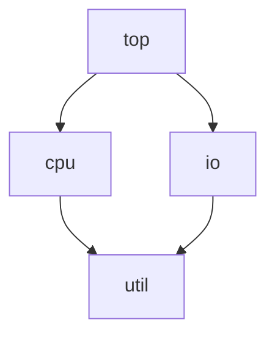

# Разработка

## Окружение и проверки

Python 3.10+ и uv. Минимальная версия закреплена в `.python-version`, зависимости —
в `uv.lock`. Ruff, mypy и CI проверяют Python 3.10. Для выбора интерпретатора используйте `UV_PYTHON=3.15 make check`.
Edify 0.3 используется на Python 3.10, Edify 1.x — на более новых версиях.
NetworkX выбирается resolver по поддерживаемой версии Python.

| Команда | Назначение |
|---|---|
| `make install` | Установить окружение из lockfile |
| `make check` | Ruff, форматирование и строгий mypy |
| `make unit` | Обычные тесты без conan_remote/performance, включая локальный Conan |
| `make integration` | Обычные тесты через временный Conan server, без performance |
| `make performance` | Отдельные замеры SDK и проверки числа операций Conan |
| `make build` | Собрать wheel и sdist |

Тесты используют отдельные Conan home и собственные серверы со случайными портами
и учётными данными. Пользовательские cache, remotes и credentials не меняются.
Переиспользуемые хелперы поставляются в `coreref.testing` (extra `[testing]`);
SDK предполагает готовую конфигурацию Conan. Docker не требуется.
CI проверяет обе группы тестов с общим порогом покрытия 95%.

## Навигация по коду

| Модуль | Ответственность |
|---|---|
| `tools/cli.py` | Подключаемые группы Typer deps/workspace без отдельной точки входа; необязательная зависимость `[cli]` |
| `api/catalog.py`, `records.py`, `query.py` | Публикация/поиск, координаты и записи, фильтры |
| `tools/manifest.py` | Необязательный стандарт YAML, пути и прямые объявления зависимостей |
| `api/operations.py` | Планы без I/O и описания шагов для logging/dry-run |
| `api/graph.py`, `workspace.py` | Разрешённый снимок и рабочие Git-копии |
| `_internal/package.py` | LocalPackage, StoredPackage и PackageGraph: операции и повторное использование рецептов/установок |
| `_internal/recipe.py`, `templates/` | Чтение метаданных и Jinja-шаблоны временных рецептов |
| `_internal/graph.py`, `client.py` | Нативный граф и команды Conan API |
| `_internal/references.py` | Кодирование координат |

Conan закреплён на 2.34.x: доступ к его внутренним объектам держать в `_internal`.
`record.json` содержит payload, координаты без собственной RREV и описание файлов;
`conandata.yml` — requires и SCM. Форматы рецептов скрыты от пользователя.
Зависимости разрешает Conan; lockfile остаётся непрозрачным для SDK.

## Правила изменений

- Сохранять короткий публичный API; доменную семантику RTL/BE/DFT оставлять flow.
- При resolve/publish отделять метаданные от изменяемых входов; точные revisions сохранять во всём снимке.
- Чтение метаданных отделять от получения файлов и SCM. Повторно использовать рецепты
  внутри операции и пакетное получение Graph; избегать отдельных install на каждый узел.
- Для изменений Conan-интеграции проверять настоящий сервер, файлы, Git-исходники,
  lockfile, разные revisions, повтор после сбоя и число команд.
- Планирование не должно создавать Catalog/Graph, вызывать Conan или сериализовать payload.
- Журналирование не должно добавлять команды или выводить payload и полные аргументы.
- Перед завершением выполнить нужные проверки и отдельно перечитать изменения на ясность.

Ruff ограничивает сложность: 6, аргументы: 5 (позиционные: 4), локальные переменные: 10,
ветви: 8, операторы: 40, вложенность: 3. Конфигурация — в `pyproject.toml`;
не отключать лимиты ради усложнённой функции. Mypy работает в strict-режиме.

Смежный проект `../hwcatalog_conan_exp` использует SDK в flow RTL/BE/DFT.
При изменении публичного контракта обновлять его вызовы и примеры одновременно.

Workspace делегирует init/add/remove и SCM open Conan. Только conanfile.py добавляется
в директорию зависимости из LocalRecord/зависимостей или опубликованных метаданных.
Workspace не импортирует tools и не читает манифесты. YAML-адаптер ManifestFile.add_to_workspace
готовит рецепт, читающий выбранный YAML; соответствующий CLI также находится в tools.
Состояние workspace хранит Conan; дополнительных метаданных в checkout SDK не создаёт.
Ref содержит только координаты; Catalog и Graph получают контекст операций явно.
Имя имеет 4 сегмента или 5 с subcomponent: namespace.component[.subcomponent].view.type.
Не добавлять новые позиционные поля без явной границы расширений: форма из 5 сегментов
уже занята необязательным subcomponent. Неизвестную грамматику отклонять.
Зависимости читают через Graph; техническое
построение поискового шаблона остаётся приватным в SearchQuery.
Graph/Ref не принимают workspace: Conan обнаруживает его из cwd.
Editable-узлы определяются по нативному статусу; source/файлы читаются из нативного
рецепта и layout. Локальные artifacts могут отсутствовать; проверка полноты скачанных
пакетов сохраняется. InstalledRecord.is_editable показывает происхождение записи.

ManifestFile — адаптер manifest.yml, не обязательный формат flow. Install читает существующий
lockfile, отдельный lock разрешает объявления заново. CLI не добавляет зависимости,
которые flow находит динамически; такой flow сохраняет lockfile итогового Graph сам.

`tools/` — необязательная надстройка: стандартный YAML и готовый CLI. Основные операции
API принимают LocalRecord и Ref; собственные форматы flow остаются возможны.
Workspace.add(directory, record=..., dependencies=...) принимает данные собственного flow.
ManifestFile.add_to_workspace(workspace) — надстройка для стандартного YAML.

## Производительность SDK

`make performance` запускает только `tests/performance/` и пишет отчёт
`.benchmarks/results.json`. В обычный `pytest`, `make unit` и `make integration`
эта группа не входит. CI запускает её отдельным job на PR/push и сохраняет отчёт
в artifact `api-performance`. Coverage и параллельные процессы для замеров не включаются.

Измеряются разрешение цепочки, широкого дерева и графа с общими зависимостями
(8/32 опубликованных узла, плюс локальный корень), разрешение с lockfile,
получение всех и выбранных файлов/исходников, поиск ссылок и метаданных
в отдельных реестрах на 10/100 пакетов, первые и повторные обходы снимка.
Файлы небольшие: это замер накладных расходов API, а не пропускной способности сети.

Состояния кэша в отчёте:

- `cold`: новый Conan home для каждого повтора. При замере получения Graph уже
  разрешён: рецепты доступны, бинарные пакеты и исходники ещё не получены.
- `disk`: предварительно заполненный Conan cache, но новый Graph для каждого повтора.
- `object` / `same-graph`: повтор на том же объекте с уже полученными данными.
- `new-graph`: первое обращение к структуре уже разрешённого снимка.

Подготовка сервера, публикация fixtures, настройка клиентов и прогрев выполняются
вне измеряемого участка. Операции Conan измеряются три раза, по одному вызову;
повторные быстрые операции со снимком используют калибровку pytest-benchmark.
Отчёт содержит все отсчёты, характеристики машины/Python, версии Conan/CoreRef/NetworkX
и параметры сценариев. Сравнивать результаты следует на одинаковом окружении;
локальный Conan server не моделирует задержки удалённой сети, Nexus или Artifactory.

Время пока информационное, без порогов в секундах. Отдельные, не измеряемые тесты
проверяют число install/graph info, отсутствие повторного чтения рецептов внутри
операции, повторных скачиваний бинарников и клонирования лишних исходников,
отсутствие I/O при чтении снимка и сохранение revisions из lockfile.
Ошибки этих проверок приводят к падению job.

Для сравнения на одной машине можно сохранить базовый запуск, затем повторить после изменений:

```sh
uv run --frozen pytest tests/performance -m performance --benchmark-save=before
uv run --frozen pytest tests/performance -m performance --benchmark-compare
```

Не использовать `--benchmark-only`, если нужны и проверки числа операций:
они намеренно не используют fixture `benchmark`. Для быстрой проверки корректности
всей группы без повторных измерений подходит `--benchmark-disable`.

## Хелперы для тестирования зависимых flow

Установите `coreref[testing]`. Основной вход — `with environment(root) as sandbox`:
он сам запускает сервер и объединяет создание Conan-клиентов, Git-репозиториев,
пакетов и workspace под одной директорией. Модуль не зависит от pytest; директории и время жизни
ресурсов задаёт вызывающий код. `local_server()` запускает собственный Conan server
и останавливает его при выходе, в том числе после ошибки. Логи и данные остаются
в переданной директории. `server.configure(home, local_sources=True)` готовит
изолированный Conan home с профилем и авторизацией; `configured_home(home)` —
cache без публичных remotes. Окружение процесса и пользовательский cache не меняются.

```python
from coreref.api.graph import Graph
from coreref.api.records import LocalRecord, Ref
from coreref.testing import environment


def test_flow(tmp_path, monkeypatch):
    with environment(tmp_path) as sandbox:
        publisher = sandbox.new_catalog()
        cpu = sandbox.package(
            Ref("soc.cpu.rtl.default/1.0"),
            sources={"cpu.sv": "module cpu; endmodule\n"},
            files={"config.json": "{}"},
        )
        # Обычный SDK задаёт payload, связи, lockfile и публикацию.
        cpu.payload = {"flow": "example"}
        published = publisher.publish(cpu)
        reader = sandbox.new_catalog()  # Независимый cache, тот же сервер.
        assert reader.get_with_sources(published.ref).files["config.json"].exists()

        workspace = sandbox.workspace(reader)
        workspace.add(cpu.source, record=cpu)
        monkeypatch.chdir(workspace.path.parent)
        graph = Graph(reader, LocalRecord(Ref("soc.top.rtl.default/1.0")), dependencies=(cpu.ref,))
        assert graph.get_with_sources()[0].is_editable
```

`Sandbox.package()` создаёт новый набор входов при каждом вызове: `sources` —
Git-checkout с коммитом и отдельным bare upstream (`origin`), `files` — упаковываемые файлы; значения —
строки или bytes. Сложные графы собираются обычными `publish(dependencies=...)`.
Для собственных фикстур доступны `git_repository(directory, files)` и
`git_upstream(checkout, directory)`: второй создаёт bare origin для готового checkout.
Изменения можно коммитить и отправлять туда обычным Git или Dulwich.
Workspace использует стандартное обнаружение Conan по текущей директории;
хелперы не переключают её автоматически. Эти средства предназначены для локальных
тестов, а не для настройки рабочего Conan-клиента или производственного реестра.

### Набор связанных пакетов

`environment()` создаёт `Sandbox`, который объединяет сервер, Git-upstreams и несколько независимых клиентов.
Иерархию задают обычные зависимости SDK; workspace нужен для локальной разработки
выбранных узлов, а не для хранения опубликованного графа.



```python
def test_package_graph(tmp_path):
    with environment(tmp_path) as sandbox:
        publisher = sandbox.new_catalog()
        links = {"util": (), "cpu": ("util",), "io": ("util",), "top": ("cpu", "io")}
        records = {
            name: sandbox.package(
                Ref(f"soc.{name}.rtl.default/1.0"),
                sources={f"{name}.sv": f"module {name}; endmodule\n"},
            )
            for name in links
        }
        # Порядок публикации вычисляется автоматически по связям.
        published = sandbox.publish_set(publisher, records, dependencies=links)

        # Чистый клиент скачивает рецепты с Conan server, исходники — из Git origins.
        graph = Graph(sandbox.new_catalog(), published["top"].ref)
        assert len(graph.get_with_sources()) == 4
```

Ключи `records` — произвольные короткие имена, не Conan Ref. Через них `dependencies`
задаёт связи. У записей могут быть любые Ref, payload, исходники и файлы.
`Sandbox.publish_set()` проверяет неизвестные имена и циклы до первой публикации,
затем возвращает опубликованные записи по тем же именам. Порядок входных записей
не важен. При ошибке самого Conan уже опубликованные пакеты остаются на сервере.

Git-upstreams — локальные bare-репозитории на файловой системе, без отдельного
Git-сервиса. Рабочие checkout можно удалить после публикации: получение исходников
по-прежнему работает из upstream. Для проверки editable-сценариев можно добавить
несколько checkout в один `Sandbox.workspace()`, передав их зависимости в
`Workspace.add(..., dependencies=...)`; остальные узлы будут получены с Conan server.

### Consumer-проекты и инкрементальные сценарии

```python
with environment(tmp_path / "infra", namespace="soc") as env:
    catalog = env.new_catalog()
    cpu = env.package(env.ref("cpu"), sources={"cpu.sv": "module cpu; endmodule"})
    published = catalog.publish(cpu)

    # Обычный ManifestFile: можно менять зависимости через add/remove/save.
    project = env.project(catalog, env.ref("top"), path=tmp_path / "top/manifest.yml")
    project.add(published.ref.without_revision())
    project.save()

    # Workspace находится над проектом; Conan обнаружит его из top/.
    workspace = env.workspace(catalog, directory=tmp_path)
    workspace.add(cpu.source, record=cpu)
```

`package(ref, source=existing_directory)` использует готовые исходники без изменения
их Git-состояния; `sources={...}` создаёт новые. Обычный `Catalog.publish()` для одного `LocalRecord`
принимает `dependencies=(published.ref, ...)`. В публикации набора значения
`dependencies` могут смешивать короткие имена и уже опубликованные `Ref`.
`ref(component, version="1.0", view="rtl", type="default")` использует namespace окружения.
`project(..., dependencies=(...))` сразу записывает зависимости; параметр `path`
позволяет выбрать собственное имя YAML и расположение проекта.

Git-хелперы поддерживают `FixtureFile(content, mode=0o755)` для исполняемых файлов.
`git_repository(directory, files)` принимает существующую директорию без Git;
`reuse=True` добавляет коммит в уже существующий репозиторий, сохраняя историю.
`git_commit(directory, files, message="Update", author="Flow <flow@example.invalid>", push=True)`
создаёт следующий коммит и отправляет его в origin. Reset не выполняется.
Тестовый профиль определяется через Conan `profiles.detect()`; существующий профиль
сохраняется. `LocalServer.configure()` по умолчанию разрешает локальные Git URL;
для явного запрета передайте `local_sources=False` в новом cache.

### Подключение к pytest

В `conftest.py` зависимого проекта достаточно указать:

```python
pytest_plugins = ["coreref.testing.pytest_plugin"]
```

Плагин предоставляет function-scoped фикстуры `coreref_environment`, `coreref_server`,
`coreref_catalog`, `coreref_project` (последний создаёт `tmp_path/manifest.yml`). Они используют
один сервер на тест, отдельный cache и автоматически освобождают сервер после ошибки.
Тесты с этими фикстурами получают маркер `coreref`: их можно выбрать через `pytest -m coreref`.
Плагин подключается явно и не меняет cwd; Conan workspace обнаруживается относительно
директории, выбранной тестом через `monkeypatch.chdir()`. Установка `coreref[testing]`
включает pytest; сам `environment()` по-прежнему можно использовать без плагина.

### Обычные проекты рядом с тестом

Для больших сценариев можно хранить проекты обычными директориями вместо словарей
с содержимым файлов внутри теста. Пример в этом репозитории:

```text
tests/
├── test_testing_projects.py
└── test_projects/
    ├── soc/                    # Локальный consumer: soc → cpu → stdlib
    │   ├── manifest.yml
    │   └── rtl/soc.sv
    ├── cpu/
    │   ├── manifest.yml
    │   ├── rtl/cpu.sv
    │   └── scripts/run.sh
    ├── stdlib/
    │   ├── manifest.yml
    │   └── rtl/stdlib.sv
    └── physical/               # Проект со своим JSON-форматом и файлами без SCM
        ├── project.json
        └── artifacts/cpu.lib
```

```python
from pathlib import Path
from coreref.testing import environment
from coreref.tools.manifest import ManifestFile


def test_soc(tmp_path):
    source = Path(__file__).with_name("test_projects")
    with environment(tmp_path, projects=source, repositories=("stdlib", "cpu")) as env:
        catalog = env.new_catalog()
        # Flow сам читает манифесты и выполняет нужные команды.
        for name in ("stdlib", "cpu"):
            project = ManifestFile(catalog, env.projects / name / "manifest.yml")
            record = project.record
            record.source = project.path.parent  # Правило данного RTL flow.
            catalog.publish(record, dependencies=project.dependencies)
        soc = ManifestFile(env.new_catalog(), env.projects / "soc/manifest.yml")
        assert len(soc.resolve().get_with_sources()) == 2
```

`projects` указывает на исходное дерево; `env.projects` — отдельная рабочая копия
с теми же именами директорий. Выбранные `repositories` получают новый Git-коммит
из существующих файлов и отдельный bare origin. Остальные директории остаются
обычными проектами без Git. Копирование сохраняет executable-биты и внутренние symlinks; абсолютные внутренние
ссылки перенаправляются в рабочую копию, внешние ссылки отклоняются до копирования;
Git-метаданные исходных репозиториев не переносятся, `.gitignore` учитывается при
создании коммита. Исходное дерево не изменяется, существующая рабочая копия не
перезаписывается. Манифесты могут иметь любой формат: helper их не разбирает
и автоматически не публикует пакеты.

В pytest можно воспользоваться тем же методом на готовой фикстуре:
`coreref_environment.load_projects(source, repositories=("stdlib", "cpu"))`.
Workspace создаётся над рабочими проектами через
`env.workspace(catalog, directory=env.projects)`. Команды flow запускаются из
`env.projects / "soc"`, чтобы Conan обнаруживал этот workspace.
Для коммита уже изменённых на диске файлов доступен `git_commit(checkout, push=True)`;
он учитывает `.gitignore`, не требует повторять содержимое файлов в Python.

Inline-создание через `env.package(..., sources={...}, files={...})` и `env.project()`
также доступно. Оба способа можно смешивать в одном окружении: загрузить базовые
проекты из директории, создать дополнительный пакет в коде и связать их обычными Ref.

`env.new_catalog()` всегда создаёт новый независимый cache; сохраните возвращённый
каталог в переменную для повторного использования. `env.publish_set(catalog, records,
dependencies=...)` публикует только именованные наборы. Одиночные записи, включая
инкрементальные обновления и зависимости на ранее опубликованные пакеты, публикуются
обычным `catalog.publish(record, dependencies=(...))`.

### Недоступность сервера и диагностика

`env.server.stop()`, `start()` и `restart()` управляют тем же сервером с сохранением
URL, credentials и опубликованных пакетов. `stop()` и `start()` идемпотентны;
контекст окружения завершает запущенный процесс и после ошибки теста.
Для быстрой проверки отказов задайте `environment(..., timeout=0.2)` или
`env.new_catalog(timeout=0.2)`. По умолчанию тестовые клиенты используют timeout 5 секунд;
это timeout HTTP-запроса, а не ограничение длительности всей операции.

`env.diagnostics()` возвращает пути рабочих проектов, созданных Conan home,
текущего server log и список успешно опубликованных через эти клиенты Ref.
Он не обращается к Conan или сети и не включает password или содержимое конфигурации.
Pytest-плагин автоматически добавляет секцию `CoreRef environment` при ошибках
setup, выполнения теста и teardown, если окружение уже было создано. Директории
остаются под управлением pytest/tmp_path; эти хелперы не включают отдельную очистку
или архивирование диагностических файлов.

### Настройки pytest-маркера

```python
@pytest.mark.coreref(
    projects="test_projects/basic",
    repositories=("cpu", "stdlib"),
    namespace="soc",
    timeout=0.2,
)
def test_flow(coreref_environment, coreref_catalog):
    projects = coreref_environment.projects
    ...
```

`projects` разрешается относительно файла теста, не cwd. Маркер можно ставить на
функцию, класс, модуль или `pytest.param(..., marks=pytest.mark.coreref(...))` для
нескольких деревьев проектов. Используется ближайший маркер; настройки не сливаются
между уровнями. Поддерживаются только `projects`, `repositories`, `namespace`, `timeout`;
ошибочные параметры дают ошибку подготовки теста. Без параметров поведение фикстур прежнее.

### Счётчики операций

```python
from coreref.testing import trace_operations

with trace_operations() as trace:
    graph.get_with_sources()
assert trace.installs == 1

with trace_operations() as cached:
    graph.get_with_sources()
assert cached.commands == ()
```

`commands` содержит снимок аргументов SDK-команд; `installs` — число попыток install,
`recipe_reads` — чтений метаданных рецептов, `source_clones` — попыток Conan Git clone.
`recipe_downloads` и `package_downloads` считают успешные GET архивов
`conan_export.tgz` и `conan_package.tgz` соответственно. Это сетевые архивы,
а не число команд download: разрешение графа тоже может скачивать рецепты.

Инструментация действует на весь Python-процесс и все каталоги внутри контекста.
Контексты не должны пересекаться или использоваться с параллельными операциями;
это средство функциональных проверок, не измерения времени. Счётчики сохраняются
после выхода, включая исключение, а перехваченные методы восстанавливаются.
