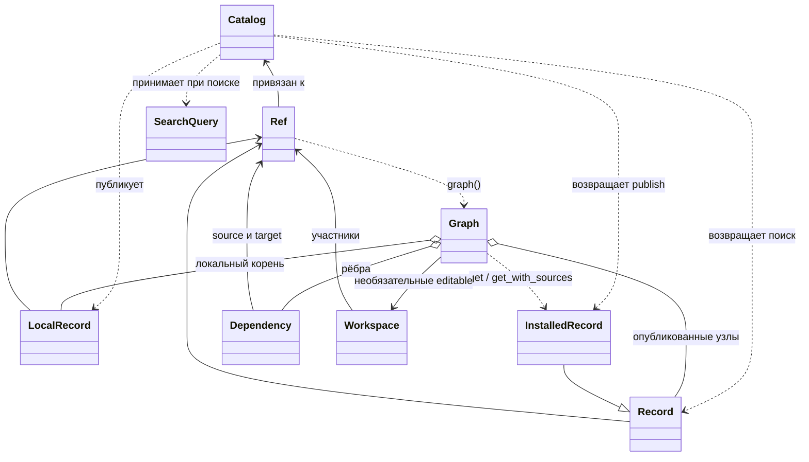

# Публичный API

## Связи классов



Стрелка зависимости в данных графа направлена от потребителя к требуемому пакету.
SDK хранит один вид связи; смысл зависимости и происхождение результатов определяет приложение.

## Ref и поиск

`Ref(reference, *, catalog)` — координаты пакета, связанные с каталогом:

```text
namespace.component[_subcomponent].view.type/version[#revision]
soc.cpu.rtl.default/1.0
soc.cpu_alu.be.lib-lef/4.0
```

`namespace` — проект, `component` — компонент, `view` — представление (`rtl`, `be`, `dft`),
`type` — его вариант. Первый `_` отделяет необязательный `subcomponent`;
в самом `component` используются буквы, цифры и дефис. Версии разных представлений независимы.

Обычно ссылку задают без `#revision`: без lockfile Conan выбирает последнюю recipe revision (RREV).
Полученные `Record.ref` и опубликованные узлы графа содержат точную revision.
Она входит в равенство и хеш Ref; `without_revision()` возвращает логические координаты.
Локальный корень задаётся без revision. Повторная публикация разрешена:
одинаковое содержимое даёт тот же RREV, изменённое — новый.

| Класс | Основные операции |
|---|---|
| `Catalog(home=None, *, remote=None, timeout=60)` | Настройки клиента; обычно достаточно `Catalog()` |
| `catalog.search(query, *, all_revisions=False)` | Метаданные `tuple[Record, ...]` |
| `catalog.search_refs(query, *, all_revisions=False)` | `tuple[Ref, ...]` без загрузки рецептов и payload |
| `catalog.publish(record, *, dependencies=(), lockfile=None)` | Один `LocalRecord` → `InstalledRecord`; также принимает готовый локальный `Graph` |
| `Ref.from_fields(namespace, component, view, type, version, *, subcomponent=None, revision=None, catalog)` | Создание из отдельных координат |
| `ref.info()` | Метаданные `Record` |
| `ref.get()` / `ref.get_with_sources()` | Файлы пакета / файлы и Git-исходники как `InstalledRecord` |
| `ref.dependency_refs(filters=None)` / `ref.dependencies(filters=None)` | Прямые требования как Ref / Record |
| `ref.graph(*, lockfile=None, workspace=None)` | Полный граф опубликованного пакета |

`SearchQuery` задаёт точные AND-фильтры: `namespace`, `component`, `subcomponent`,
`view`, `type`, `version`, `revision`. Значение `None` пропускает фильтр, кроме
`subcomponent`: здесь `None` выбирает целый компонент, `"*"` (по умолчанию) включает его части.
Остальные поля не принимают glob-шаблоны.
`SearchQuery.for_component(ref, *, view=None, type=None, version=None, revision=None)`
сохраняет namespace/component/subcomponent, а версию и revision выбирает независимо.
`matches_ref`, `matches` и `select` позволяют фильтровать уже полученные данные.

`query` обязателен; поиск без ограничений — `catalog.search(SearchQuery())`.
По умолчанию возвращаются последние revisions; `all_revisions=True` включает историю.
Явный фильтр `revision` работает в обоих режимах.

## Записи

| Класс | Поля и назначение |
|---|---|
| `LocalRecord(ref, payload=None, source=None, files=...)` | Изменяемое описание проекта: Git-каталог и локальные файлы для упаковки |
| `Record(ref, payload=None, *, file_names=(), has_source=False)` | Метаданные: Ref, JSON payload, имена файлов и наличие SCM |
| `InstalledRecord(record, *, files=None, source=None)` | Метаданные и готовые пути к файлам/исходникам; обычно возвращается SDK |

`files` сопоставляет имя файла внутри пакета с локальным `Path`; по умолчанию карта пуста.
`LocalRecord.source` — рабочий Git-репозиторий; при публикации Conan фиксирует SCM-координаты.
`InstalledRecord.source` — полученный checkout, либо `None`.
`sources_ready` показывает, получены ли исходники или пакет их не объявляет.
`Record` и `InstalledRecord` доступны только для чтения, включая payload и карту файлов.
Пути Conan cache используются для чтения; рабочие изменения выполняют в отдельной копии.

Payload принимает JSON или объект с `to_json() -> str` (`JSONSerializable`).
Его схему, списки RTL-файлов, NFS-пути и их проверку определяет приложение.
`LocalRecord.to_json()` подготавливает метаданные пакета;
`Record.to_dict()` и `Record.from_json(data, *, catalog)` предназначены для снимков.

## Graph и Workspace

`Graph(catalog, record, *, dependencies=(), lockfile=None, workspace=None)` сразу
разрешает локальный `LocalRecord` или опубликованный `Ref`. Публиковать локальный корень не требуется.
Формат deps.toml и дополнительные зависимости определяет приложение.

| API Graph | Результат |
|---|---|
| `record`, `records`, `edges`, `requirements` | Корень, все метаданные, связи `Dependency(source, target)`, прямые Ref корня |
| `info(ref)` | Метаданные выбранного узла без I/O |
| `dependencies(ref=None, *, transitive=False, filters=None)` | Прямые или все зависимости без корня; транзитивные — зависимости первыми |
| `ordered_refs(root, *, stop_at=())`, `ordered_records(...)` | Обход с корнем; у stop_at не обходятся зависимости, сами узлы включены |
| `get(refs=None)`, `get_with_sources(refs=None)` | Пакетное получение файлов / файлов и SCM; `tuple[InstalledRecord, ...]` |
| `create_lockfile(path=None)`, `lockfile` | Сохранение выбора Conan и путь проектного lockfile |
| `networkx` | Кэшируемая топология только для чтения; `.copy()` для изменений |
| `editables` | Выбранные рабочие копии Workspace |

Без refs получение охватывает все опубликованные узлы, зависимости первыми;
локальный корень исключён. Явный `()` означает пустую выборку.
Полученные записи повторно используются в пределах Graph. Для всего дерева удобнее
один вызов Graph, чем отдельный get для каждого Ref.

Graph сохраняет независимый снимок метаданных и revisions; изменения проекта или сервера
его не пересчитывают. Для нового выбора создают новый Graph.
Незакреплённый Ref сопоставляется с узлом снимка; несовпадающая явная revision отклоняется.
Lockfile принадлежит проекту и используется при разрешении. SDK сохраняет его средствами
Conan, не разбирая JSON. Получение файлов использует уже разрешённый выбор.
`catalog.publish(graph)` сохраняет зависимости снимка; переопределять их и lockfile нельзя.

`Workspace(catalog, path="workspace.yaml")` хранит выбранные editable в проектном YAML.
`add(ref, *, directory=None)` получает Git-копию (по умолчанию рядом с проектом) и возвращает
InstalledRecord; `remove(ref)` снимает регистрацию, сохраняя копию и правки.
`members` возвращает карту Ref → Path. Workspace передаётся в Graph явно;
пока поддерживаются только SCM-пакеты без упакованных файлов.

Ошибки: `CatalogError` — общий сбой, `NotFound` — отсутствие пакета,
`Conflict` — конфликт зависимостей, `InvalidPackage` — неверное описание/содержимое.
Conan-профили, remote и доступ к Git настраиваются заранее. Publish требует сервер;
чтение точных revisions из cache и локальные графы доступны без него.
