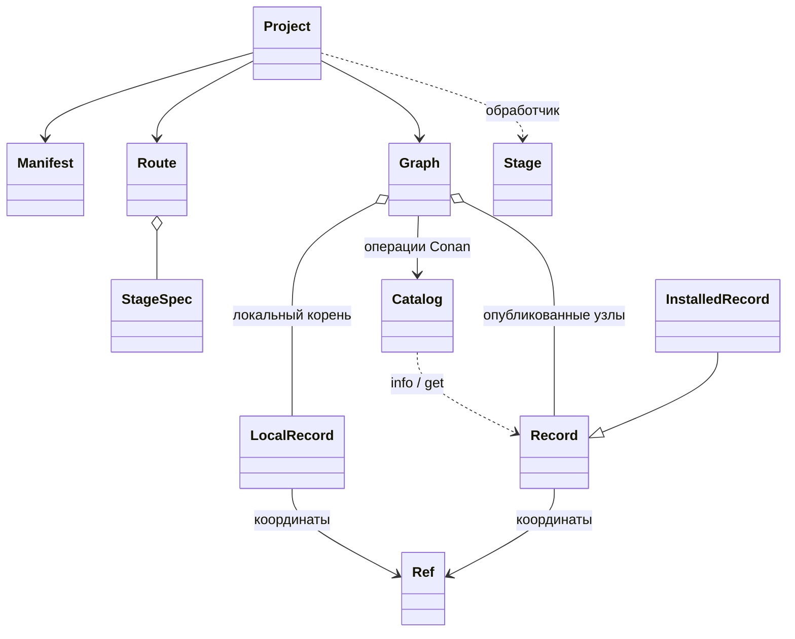

# Публичный API

## Основная идея

Каталог хранит версии аппаратных компонентов, библиотек и других входов flow.
Один пакет компонента может содержать Git-исходники RTL, netlist и файлы физической
реализации. Flow получает нужные данные из ревизии, выбранной для проекта.

```text
namespace.component/version[#revision]
```

| Поле | Смысл | Пример |
|---|---|---|
| `namespace` | Пространство имён, обычно проект | `soc` |
| `component` | Имя компонента или библиотеки | `cpu`, `stdlib` |
| `version` | Версия пакета | `1.0` |
| `revision` | Необязательная точная recipe revision Conan | Вычисляется по содержимому |

Пакет `soc.cpu/1.0` может сначала содержать RTL, а в следующей ревизии также netlist,
Liberty и LEF. При публикации flow объявляет фактический состав. Зависимый проект
закрепляет нужную ревизию через lockfile. Вид компонента и смысл его файлов
приложение может описать в метаданных пакета.

## Основные возможности

- **Формат проекта.** `Manifest` читает стандартный manifest.yml.
  Он описывает зависимости, версии инструментов и опции проекта. Рецепт для
  обычной публикации создаёт SDK.
- **Публикация и поиск.** Один пакет объединяет JSON payload, упакованные файлы и
  необязательные Git-исходники через SCM. Поиск работает по полям Ref; внешние пути,
  например NFS, приложение может хранить в payload.
- **Работа с деревом в Python.** Graph разрешает локальный неопубликованный проект
  или опубликованный пакет, предоставляет связи и порядок обхода. Метаданные можно
  читать отдельно от получения файлов и исходников; получить можно всё дерево или выбранные узлы.
- **Фиксация выбора.** Проектный lockfile сохраняет версии/revisions для последующих
  разрешений. Уже созданный Graph использует свой снимок выбора при получении пакетов.
- **Совместная разработка зависимостей.** Workspace получает SCM-зависимости
  в рабочие Git-копии или подключает существующие проекты с manifest.yml без Git и публикации.
  Conan автоматически подставляет рабочие копии в Graph из текущей директории;
  регистрации хранит Conan в conanws.yml. Локальные artifacts могут быть ещё не созданы.

## Связи классов

Из `coreref.api.packages` импортируют координаты и каталог. В
`coreref.api.projects` находятся манифест, проект, граф и workspace.
`coreref.api.build` предоставляет описание маршрута и доступ к его выходам.



Стрелка зависимости в данных графа направлена от потребителя к требуемому пакету.

## Ref и поиск

`Ref(reference)` — самостоятельные координаты без каталога и операций Conan.
Один Ref можно передать любому Catalog; создание и сравнение Ref не выполняют I/O.
Имя состоит из двух сегментов `namespace.component`. В сегментах допустимы
строчные латинские буквы, цифры, подчёркивания и дефисы. Версия отделена знаком
`/`, revision — знаком `#`. Пакеты со старыми адресами нужно опубликовать под
новым именем, а зависимости и lockfile обновить.

| Класс | Основные операции |
|---|---|
| `Catalog(home=None, *, remote=None, timeout=60)` | Настройки клиента; обычно достаточно `Catalog()` |
| `catalog.search_refs(query, *, all_revisions=False)` | `tuple[Ref, ...]` без загрузки рецептов и payload |
| `catalog.publish(record, *, dependencies=(), lockfile=None)` | Один `LocalRecord` → `InstalledRecord`; также принимает готовый локальный `Graph` |
| `Ref.from_fields(namespace, component, version, *, revision=None)` | Создание из отдельных координат |
| `catalog.info(ref)` | Метаданные `Record` |
| `catalog.get(ref, *, with_sources=False)` | Файлы пакета / файлы и Git-исходники как `InstalledRecord` |
| `Graph(catalog, ref, *, lockfile=None)` | Полный граф пакета из реестра или editable из workspace |

`SearchQuery` задаёт точные фильтры `namespace`, `component`, `version` и
`revision`. Поле со значением `None` пропускается.
`matches_ref` и `matches` проверяют уже полученные ссылки и записи.
Фильтры зависимостей задаются в Graph.

`query` обязателен; поиск без ограничений — `catalog.search_refs(SearchQuery())`.

## Диапазоны версий

`Requirement("shared.stdlib/[>=1.0 <2.0]")` задаёт диапазон Conan для зависимости.
Его можно передать вместе с `Ref` в `dependencies` методов `Graph`, `Catalog.publish`
и `Workspace.add`. Диапазон не содержит `#revision`. Корень и операции получения
конкретного пакета используют `Ref` с версией. Функция `parse_dependency(text)`
разбирает строку манифеста в `Ref` или `Requirement`.

При публикации Conan-рецепт сохраняет каждую прямую зависимость в объявленном виде.
Это может быть диапазон, версия без revision или точный `Ref` с revision. Например, если CPU и DMA
объявили `shared.stdlib/[>=1.0 <2.0]`, SoC может выбрать для обоих версию 1.3,
даже если CPU проверяли с 1.2. Выбор для конкретного запуска хранится в lockfile
соответствующего проекта. SoC разрешает граф по рецептам пакетов и своему lockfile.

`graph.dependencies()` возвращает метаданные с уже выбранными прямыми `Ref`. Потребитель LIB/LEF
получает файлы из выбранной ревизии зависимости.

## Ревизии

У одной версии пакета может быть несколько recipe revisions Conan (RREV).
`Ref.revision` задаёт RREV; ревизии бинарных пакетов (PREV) в Ref не представлены.

| Ссылка | Значение |
|---|---|
| `soc.cpu/1.0` | Версия без закрепления revision; обычный способ задать зависимость |
| `soc.cpu/1.0#<RREV>` | Конкретная revision этой версии; вместо `<RREV>` подставляется её хеш |

При самостоятельном info/get незакреплённый Ref выбирает последнюю revision средствами
Conan. Полученные из каталога Record и опубликованные узлы Graph содержат точные Ref.
Revision участвует в равенстве и хеше; `without_revision()` снимает её закрепление.
Search/search_refs по умолчанию возвращают последние revisions; `all_revisions=True`
включает историю, а `SearchQuery(revision=...)` выбирает конкретную revision.

Локальный корень LocalRecord задаётся без revision. Повторный publish одной версии
разрешён: Conan вычисляет RREV по содержимому, одинаковое содержимое даёт тот же RREV.
Publish возвращает Ref опубликованной revision внутри InstalledRecord.

Graph фиксирует выбранные revisions при разрешении и продолжает получать их после
появления новых revisions на сервере. Ref без revision в методах Graph обозначает
узел этого снимка; несовпадающая явная revision отклоняется. Проектный lockfile переносит
сохранённый выбор между запусками; конфликт явного RREV с lockfile вызывает ошибку.

## Записи

| Класс | Поля и назначение |
|---|---|
| `LocalRecord(ref, payload=None, source=None, files=...)` | Рабочие данные команды: изменяемые payload, source и словарь files |
| `Record(ref, payload=None, *, file_names=(), has_source=False)` | Метаданные: Ref, JSON payload, имена файлов и наличие исходников |
| `InstalledRecord(record, *, files=None, source=None, is_editable=False)` | Метаданные и готовые пути к файлам/исходникам; обычно возвращается SDK |

`files` сопоставляет имя файла внутри пакета с локальным `Path`; по умолчанию карта пуста.
При публикации `LocalRecord.source` — рабочий Git-репозиторий: Conan фиксирует SCM-координаты.
При локальной регистрации source может быть обычной директорией.
`InstalledRecord.source` — полученный checkout или локальные исходники, либо `None`.
`sources_ready` показывает, получены ли исходники или пакет их не объявляет.
`Record` и `InstalledRecord` доступны только для чтения, включая payload и карту файлов.
Пути Conan cache используются для чтения; рабочие изменения выполняют в отдельной копии.

Payload принимает JSON или объект с методом `to_json() -> str`.
Его схему, списки RTL-файлов, NFS-пути и их проверку определяет приложение.
`LocalRecord.to_json()` подготавливает метаданные пакета;
`Record.to_dict()` предоставляет данные для вывода в CLI и пользовательской сериализации.
Метаданные скачанных пакетов читает внутренняя реализация SDK.

## Graph и Workspace

`Graph(catalog, record, *, dependencies=(), lockfile=None)` сразу
разрешает локальный `LocalRecord` или опубликованный `Ref` через явно переданный каталог.
Публиковать локальный корень не требуется. Прямые зависимости опубликованного пакета
доступны через `Graph(catalog, ref).dependencies()`.
Связи снимка можно читать через `graph.edges`.
Для проекта со стандартным манифестом готовый граф доступен через `project.graph`.
Приложение также может построить Graph со своим набором зависимостей.

| API Graph | Результат |
|---|---|
| `record`, `records` | Корень и все метаданные снимка |
| `info(ref)` | Метаданные выбранного узла без I/O |
| `dependencies(ref=None, *, transitive=False, filters=None)` | Прямые или все зависимости без корня; транзитивные — зависимости первыми |
| `get(refs=None, *, with_sources=False)` | Пакетное получение файлов / файлов и SCM; `tuple[InstalledRecord, ...]` |
| `get_sources(refs)` | Получение SCM для выбранных ссылок без загрузки бинарных пакетов. Возвращает `dict[Ref, Path]` с точными `Ref`. Для пакетов без SCM записи пропускаются. |
| `create_lockfile(path=None)`, `lockfile` | Сохранение выбора Conan и путь проектного lockfile |
| `edges` | Неизменяемые пары Ref от потребителя к зависимости |

Без refs получение охватывает все опубликованные узлы, зависимости первыми;
локальный корень исключён. Явный `()` означает пустую выборку.
`graph.dependencies(filters=SearchQuery(namespace="shared"))` выбирает метаданные узлов
в снимке. Для загрузки выбранных узлов передайте их Ref в `get()` или `get_sources()`.
Полученные записи повторно используются в пределах Graph. Для всего дерева удобнее
один вызов Graph, чем отдельный get для каждого Ref.

Graph фиксирует зависимости и выбранные revisions, а локальный корень остаётся рабочим
LocalRecord: `graph.record is record`, переданный в конструктор. Через `record`, `records`,
и `info` доступен тот же объект. Payload, source и files можно дополнить
после запуска инструмента и затем вызвать `catalog.publish(graph)` без повторного разрешения.
Payload сериализуется при публикации, а не при разрешении графа.
Координаты корня и состав зависимостей меняют через новый Graph; старый результат
разрешения автоматически не пересчитывается. Метаданные опубликованных узлов остаются
только для чтения.
Lockfile принадлежит проекту и используется при разрешении. SDK сохраняет его средствами
Conan, не разбирая JSON. Если переданного пути ещё нет, Graph разрешает зависимости
без lockfile и запоминает этот путь для последующего `create_lockfile()` без аргумента.
Существующий некорректный файл вызывает ошибку; он не игнорируется.
Разрешение само по себе не записывает lockfile:
`create_lockfile(path)` явно создаёт или перезаписывает файл снимком текущего Graph,
без повторного разрешения зависимостей. Получение файлов использует уже разрешённый выбор.
`catalog.publish(graph)` упаковывает последние данные локальной записи с выбором
версий из этого Graph. В рецепт попадают исходные объявления прямых зависимостей.
`Workspace(catalog, path="conanws.yml")` — небольшая обёртка над Conan init/add/remove.
Conan создаёт conanws.yml/conanws.py и управляет составом workspace. SDK не ведёт свой
реестр. Из текущей директории проекта Conan автоматически выбирает рабочие пакеты:
передавать workspace в Graph или Ref не нужно.

| Операция | Назначение |
|---|---|
| `init()` | Создать нативный workspace |
| `add(directory, *, record=None, dependencies=())` | Подключить готовый рецепт либо подготовить его из данных flow |
| `open(ref, *, directory=None)` | Получить Git-копию через SCM Conan и подключить её; по умолчанию рядом с проектом |
| `remove(directory)` | Убрать регистрацию, сохранив директорию и изменения |
| `members` | Прочитать Ref и пути из Conan |

Workspace не читает манифесты проекта. `add(directory)` регистрирует имеющийся рецепт;
`add(directory, record=local_record, dependencies=refs)` создаёт отсутствующий
**conanfile.py** из готовых данных flow. Для скачанной через `open` копии используются
метаданные опубликованного пакета. Существующий рецепт сохраняется. Дополнительные
record.json/conandata.yml и собственные маркеры в рабочей директории не создаются.
Сгенерированные файлы остаются untracked; SDK не меняет Git index или ignore.

`InstalledRecord.is_editable` показывает выбор Conan. У editable source указывает
в рабочую директорию, а files — на локальные пути (по умолчанию artifacts/); эти файлы
могут появиться позднее после локальной сборки. Сравнивать package/source пути для
определения editable не требуется. Revision editable-ссылок определяется Conan;
это не гарантированная revision опубликованной версии рабочей копии.

```python
from coreref.api.projects import Graph, Workspace

workspace = Workspace(catalog)  # запускаем из корня проекта
workspace.add("../cpu", record=cpu_record, dependencies=cpu_dependencies)
# cpu_record и cpu_dependencies сформированы парсером конкретного flow.
# workspace.open(rtl_ref)       # либо Git-копия опубликованной зависимости
graph = Graph(catalog, rtl_ref)  # Conan уже видит зарегистрированную директорию
ready = graph.get((graph.record.ref,), with_sources=True)
local = [record for record in ready if record.is_editable]
```

Изменение состава workspace требует нового Graph. Его метаданные — снимок,
но файлы рабочей копии остаются изменяемыми.
Ошибки: `CatalogError` — общий сбой, `NotFound` — отсутствие пакета,
`Conflict` — конфликт зависимостей, `InvalidPackage` — неверное описание/содержимое.
Ошибки Conan переводятся в сообщения SDK; исходное исключение доступно через `__cause__`.
Профили, remote и доступ к Git настраиваются заранее. Publish требует сервер.

## Готовые команды для CLI flow

Дополнение `coreref[cli]` предоставляет группу Typer для workspace: `init`, `add`, `open`, `remove`, `list`. Её можно подключить к CLI любого flow без собственного разбора Ref и обработки
ошибок workspace. Каталог создаётся только при выполнении команды; справка не обращается
к Conan.

```python
import typer
from coreref.cli import create_workspace_app

app = typer.Typer()
app.add_typer(create_workspace_app(), name="workspace")
```

```sh
flow workspace open soc.cpu/1.0 --project-dir ./project
flow workspace add ../existing-cpu --project-dir ./project
flow workspace list --project-dir ./project
flow workspace remove ../existing-cpu --project-dir ./project
```

Готовая команда `add DIRECTORY` из `coreref.cli` читает `DIRECTORY/manifest.yml`, если рецепта ещё нет:
достаточно валидного YAML с `ref`. Класс Workspace от этого формата не зависит.
`dependencies`, `files` и `payload` необязательны; пути считаются от директории YAML.
Рецепт читает выбранный YAML при следующих вызовах Conan, поэтому его изменения
подхватываются без повторной регистрации. Файл может называться произвольно. Например:

```yaml
ref: soc.cpu/1.0
dependencies:
  - soc.util/1.0
```

`open --directory` задаёт точную директорию Git-копии. По умолчанию
она располагается рядом с проектом. Допускается точный Ref с `#revision`.
`list` выводит координаты и пути Conan, `remove` сохраняет рабочую копию.
Инициализация workspace происходит автоматически при `add`/`open`.
Пустой `list` ничего не создаёт.

По умолчанию используются стандартные настройки Conan, включая `CONAN_HOME`.
Для настроек из приложения передайте фабрику: например,
`create_workspace_app(catalog_factory=lambda: catalog)`, где `catalog` создан самим flow.
Разные подключения не разделяют состояние CLI.

Готовая группа команд для manifest.yml описана ниже.

## Варианты компонентов

`Project.lock()` фиксирует выбор рецептов для обычных и именованных зависимостей.
`project.install_variants(build_missing=True)` устанавливает все конфигурации из
манифеста. Для одного варианта есть `catalog.get_variant(PackageInput(ref, options),
lockfile=project.lockfile)`. Значение `build_missing=True` разрешает Conan
собрать отсутствующий бинарник. Возвращаемый `ConfiguredPackage` содержит
директорию и точные координаты бинарника.

Flow публикует рецепт генератора через `catalog.publish_variant_recipe(ref,
options=..., inputs=..., runner=...)`. Например, `options={"depth": (128, 256),
"width": (32, 64)}` задаёт четыре комбинации, с 128×32 по умолчанию. Python-скрипт
реализует `generate(options, source, output)`. Он читает именованные файлы из
`source` и сохраняет результаты в `output`. Готовый вариант можно отправить
в реестр через `catalog.publish_variant(package)`.

## Проект и стадии

`coreref.api.projects.Project` связывает манифест, рабочую директорию и каталог.
Он создаёт `LocalRecord`, разрешает граф по `manifest.lock` и обновляет lockfile
вместе с именованными вариантами. Для работы с маршрутом достаточно
`project.build("floorplan")` и `project.publish()`. Сборка сама выбирает
предшественников. Публикация выбирает максимальные готовые стадии выпуска
или принимает явно указанную цель, собирает срез и проверяет неизменность
его входов. Локальные результаты лежат в `project.build_dir`.

`Graph.dependencies(transitive=True, stop_at=...)` оставляет пограничные
пакеты и общие зависимости, достижимые через другие ветви. Flow может
использовать это для замены RTL макроблока его физическими представлениями.

Для реализации маршрута Flow предоставляет `Route` и по одному `Stage` на
каждый `StageSpec`. `StageSpec` задаёт имя, связи и выходы, а `Stage` связывает
его с действием, файлами и параметрами. CoreRef использует это описание
для локального выполнения, среза и сборки по рецепту. Готовность стадии
и обязательные проверки перед выпуском определяет Flow.

`Route.load(project, fragments=...)` собирает `flow.yml` из локальных
`imports`, именованных фрагментов `use` и стадий проекта.
`overrides.<stage>.add_needs` добавляет зависимости к любой стадии маршрута.
Flow может передать `select`, чтобы обработать свои поля корневого YAML
и выбрать стадии до валидации графа.

`publish(with_producers=True)` вместе с результатами публикует рецепты
пересборки, если их объявил flow. Flow задаёт путь к функции
`module:function` и сопоставляет имена входов с выходами других пакетов.
CoreRef закрепляет точные рецепты и запускает обработчик в Python-окружении
производителя по его `uv.lock`. Обработчик получает имя стадии, рабочую
директорию, путь лога и настройки стадии и маршрута. Если проект объявляет
обработчик пересборки, CoreRef автоматически включает `pyproject.toml`,
`uv.lock` и `.python-version` производителя в идентичность среза.

## Именованные выходы

`Outputs(catalog).get(record, names)` загружает только указанные выходы
закреплённой ревизии. В подклассе `Project` доступен `project.outputs`,
настроенный по группам выходов flow. С `build_missing=True` CoreRef может
собрать запрошенный результат, если для него опубликован рецепт.
`outputs.available(record)` перечисляет доступные имена без загрузки,
`Outputs.links(record)` возвращает точные Ref готовых файлов.

В lockfile закреплена ревизия оглавления. Точные ссылки на дочерние артефакты
хранятся в этой ревизии. Срез вычисляется из объявленных входов, lockfile,
разрешённых зависимостей, вариантов и окружения. Общий кэш стадий может
использовать байты подготовленных входов и идентичность инструмента для
переиспользования результата между срезами. [Conan lockfiles](https://docs.conan.io/2/tutorial/versioning/lockfiles.html)

## Стандартный manifest.yml

`Manifest.load(path)` читает стандартный манифест и проверяет его схему.
Для построения графа передайте этот манифест, корневую директорию и каталог в
`Project`. Для редактирования YAML flow может подключить готовую группу
команд `deps`.

```yaml
ref: soc.top/1.0
dependencies:
  - soc.cpu/1.0
  - soc.gpio/2.0#exact-revision
  - "shared.stdlib/[>=1.0 <2.0]"
  - foundry.techlib-n5/3.2
```

Обязателен только `ref` с конкретной версией без собственной revision.
`dependencies` принимает обычные Ref, диапазоны Conan в квадратных скобках
и именованные конфигурации вида `{name: cache, ref: demo.sram/1.0, options: {depth: 4}}`.
Сами допустимые значения генератора задаются в `options` проекта, например
`options: {depth: [4, 8], width: [4, 8]}`. Все flow используют одну схему
`coreref.api.projects.Manifest`. Поле `type` задаёт тип проекта, а
`release_through` ссылается на стадию выпуска из flow.yml. В `tools` можно
закрепить образ по SHA-256 или версию исполняемой команды. При загрузке с
`flow_package=` CoreRef проверяет установленную версию flow по `flow_version`.
Flow получает закреплённый образ через `manifest.image(name)` или проверяет
локальный исполняемый файл через `manifest.command(name)`. Последний возвращает
путь и подтверждённую версию.

Поля `files` и `payload` можно опустить. `files` сопоставляет имя результата
пути относительно корня проекта. `Project` использует этот корень как SCM-исходники.
При публикации обычного пакета напрямую через `Catalog` исходники можно
задать с помощью `LocalRecord.source`.

Для подключения команд установите `coreref[cli]` и включите нужные группы
в CLI своего flow. Ниже `flow` — имя приложения, подключившего группу `deps`:

```sh
flow deps init soc.top/1.0
flow deps add soc.cpu/1.0
flow deps add 'shared.stdlib/[>=1.0 <2.0]'
flow deps list
flow deps lock
flow deps install
```

`install` получает файлы и Git-исходники всего дерева одной пакетной установкой,
показывает точные Ref и локальные пути в JSON. `--no-sources` оставляет получение файлов.
Локальный корень не устанавливается: он уже доступен в проекте.
`install` учитывает существующий lockfile, не создаёт и не обновляет его.
После изменения объявлений или для выбора новых revisions вызывают `lock` отдельно.
Любая команда `deps` принимает `--file`/`-f`; несколько YAML в одном проекте имеют
отдельные lockfile. Для удаления объявления используется `deps remove REF`.

Группы подключаются независимо; CoreRef не устанавливает отдельную точку входа CLI:

```python
import typer
from coreref.cli import create_deps_app

app = typer.Typer()
app.add_typer(create_deps_app(), name="deps")
```

Фабрика `catalog_factory` вызывается только для `lock` и `install`;
`init/add/remove/list` работают с YAML без каталога.
Готовые команды используют только зависимости из YAML. Если flow добавляет найденные
пакеты программно, он формирует итоговый Graph и его lockfile своим кодом.
Для этого доступны `manifest.local_record(root)` и `manifest.requirements`.

Ошибка клонирования или регистрации возвращается как ошибка SDK с исходной причиной.
SDK не удаляет рабочие директории при сбое: неполную копию можно проверить и убрать вручную.

Неверные поля `SearchQuery` отклоняются при создании с `InvalidPackage`.
Корректный запрос без совпадений возвращает пустой результат. Неизвестные Ref,
несовпадающие revisions в методах Graph также дают
`InvalidPackage`.
