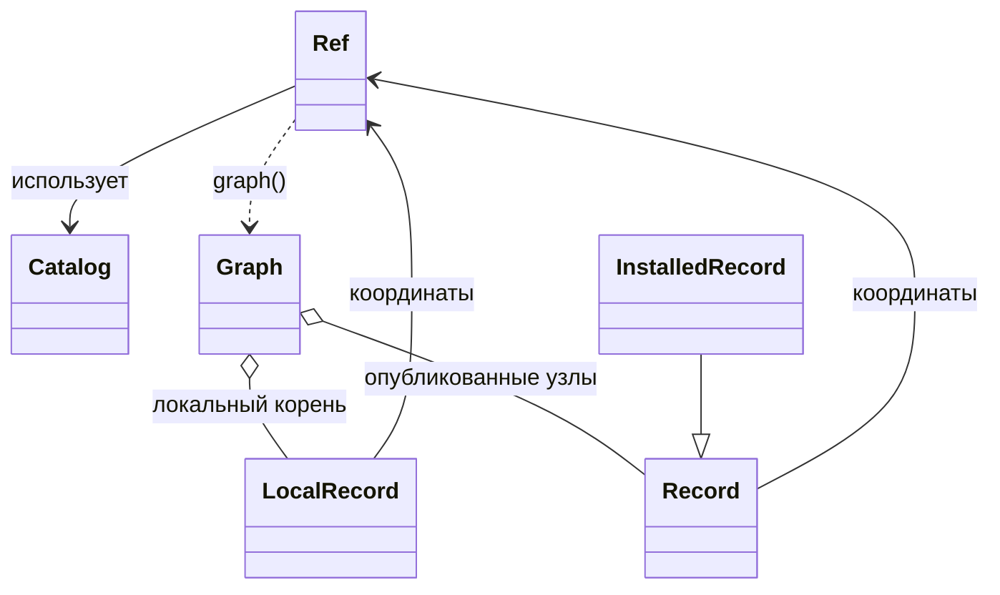

# Публичный API

## Основная идея

Каталог хранит пакеты, каждый из которых описывает одно представление аппаратного
компонента: RTL, DFT-результат, BE LIB/LEF и другие. Основа API — `Ref`: его поля
задают смысл пакета и позволяют найти другие представления того же компонента.

```text
namespace.component[_subcomponent].view.type/version[#revision]
```

| Поле | Смысл | Пример |
|---|---|---|
| `namespace` | Пространство имён, обычно проект | `soc` |
| `component` | Компонент внутри проекта | `cpu` |
| `subcomponent` | Необязательная часть компонента | `alu` в `cpu_alu` |
| `view` | Представление компонента | `rtl`, `dft`, `be` |
| `type` | Вариант внутри представления | `default`, `output`, `scan`, `lib-lef` |
| `version` | Версия конкретного представления | `1.0` |
| `revision` | Необязательная точная recipe revision Conan | Вычисляется по содержимому |

Например, `soc.cpu.rtl.default/1.0` и `soc.cpu.be.lib-lef/4.0` относятся к одному
компоненту, но имеют независимые версии. По namespace/component/subcomponent находят
кандидатов нужного view/type. Соответствие конкретному RTL подтверждают зависимости
с точной revision или метаданные приложения. Само совпадение полей не гарантирует совместимость.
Значения view/type и смысл зависимостей определяет flow; специальных типов рёбер в SDK нет.

## Основные возможности

- **Формат проекта.** Готовый `DepsFile` читает рекомендуемый deps.yaml; приложение
  может выбрать свой формат и создать `LocalRecord` и набор Ref. Файл может содержать часть зависимостей; остальные
  приложение добавляет по результатам поиска или других правил. Рецепты Conan SDK создаёт сам.
- **Публикация и поиск.** Один пакет объединяет JSON payload, упакованные файлы и
  необязательные Git-исходники через SCM. Поиск работает по полям Ref; внешние пути,
  например NFS, приложение может хранить в payload.
- **Работа с деревом в Python.** Graph разрешает локальный неопубликованный проект
  или опубликованный пакет, предоставляет связи и порядок обхода. Метаданные можно
  читать отдельно от получения файлов и исходников; получить можно всё дерево или выбранные узлы.
- **Фиксация выбора.** Проектный lockfile сохраняет версии/revisions для последующих
  разрешений. Уже созданный Graph использует свой снимок выбора при получении пакетов.
- **Совместная разработка зависимостей.** Workspace получает выбранные SCM-зависимости
  в рабочие Git-копии рядом с проектом. Graph с этим workspace использует локальные правки;
  регистрации хранит Conan в conanws.yml. Локальные artifacts могут быть ещё не созданы.

## Связи классов



Стрелка зависимости в данных графа направлена от потребителя к требуемому пакету.

## Ref и поиск

`Ref(reference, *, catalog)` связывает координаты с конкретным каталогом.
Первый `_` отделяет subcomponent: `soc.cpu_alu.be.lib-lef/4.0`.
В самом component используются буквы, цифры и дефис.

| Класс | Основные операции |
|---|---|
| `Catalog(home=None, *, remote=None, timeout=60)` | Настройки клиента; обычно достаточно `Catalog()` |
| `catalog.search(query, *, all_revisions=False)` | Метаданные `tuple[Record, ...]` |
| `catalog.search_refs(query, *, all_revisions=False)` | `tuple[Ref, ...]` без загрузки рецептов и payload |
| `catalog.publish(record, *, dependencies=(), lockfile=None)` | Один `LocalRecord` → `InstalledRecord`; также принимает готовый локальный `Graph` |
| `Ref.from_fields(namespace, component, view, type, version, *, subcomponent=None, revision=None, catalog)` | Создание из отдельных координат |
| `ref.info()` | Метаданные `Record` |
| `ref.get()` / `ref.get_with_sources()` | Файлы пакета / файлы и Git-исходники как `InstalledRecord` |
| `ref.dependency_refs(filters=None)` / `ref.dependencies(filters=None)` | Прямые требования как Ref / Record |
| `ref.graph(*, lockfile=None, workspace=None)` | Полный граф опубликованного пакета |

`SearchQuery` задаёт точные AND-фильтры: `namespace`, `component`, `subcomponent`,
`view`, `type`, `version`, `revision`. Значение `None` пропускает фильтр, кроме
`subcomponent`: здесь `None` выбирает целый компонент, `"*"` (по умолчанию) включает его части.
Остальные поля не принимают glob-шаблоны.
`SearchQuery.for_component(ref, *, view=None, type=None, version=None, revision=None)`
сохраняет namespace/component/subcomponent, а версию и revision выбирает независимо.
`matches_ref`, `matches` и `select` позволяют фильтровать уже полученные данные.

`query` обязателен; поиск без ограничений — `catalog.search(SearchQuery())`.

## Ревизии

У одной версии пакета может быть несколько recipe revisions Conan (RREV).
`Ref.revision` задаёт RREV; ревизии бинарных пакетов (PREV) в Ref не представлены.

| Ссылка | Значение |
|---|---|
| `soc.cpu.rtl.default/1.0` | Версия без закрепления revision; обычный способ задать зависимость |
| `soc.cpu.rtl.default/1.0#<RREV>` | Конкретная revision этой версии; вместо `<RREV>` подставляется её хеш |

При самостоятельном info/get незакреплённый Ref выбирает последнюю revision средствами
Conan. Полученные из каталога Record и опубликованные узлы Graph содержат точные Ref.
Revision участвует в равенстве и хеше; `without_revision()` снимает её закрепление.
Search/search_refs по умолчанию возвращают последние revisions; `all_revisions=True`
включает историю, а `SearchQuery(revision=...)` выбирает конкретную revision.

Локальный корень LocalRecord задаётся без revision. Повторный publish одной версии
разрешён: Conan вычисляет RREV по содержимому, одинаковое содержимое даёт тот же RREV.
Publish возвращает Ref опубликованной revision внутри InstalledRecord.

Graph фиксирует выбранные revisions при разрешении и продолжает получать их после
появления новых revisions на сервере. Ref без revision в методах Graph обозначает
узел этого снимка; несовпадающая явная revision отклоняется. Проектный lockfile переносит
сохранённый выбор между запусками; конфликт явного RREV с lockfile вызывает ошибку.

## Записи

| Класс | Поля и назначение |
|---|---|
| `LocalRecord(ref, payload=None, source=None, files=...)` | Изменяемое описание проекта: Git-каталог и локальные файлы для упаковки |
| `Record(ref, payload=None, *, file_names=(), has_source=False)` | Метаданные: Ref, JSON payload, имена файлов и наличие SCM |
| `InstalledRecord(record, *, files=None, source=None)` | Метаданные и готовые пути к файлам/исходникам; обычно возвращается SDK |

`files` сопоставляет имя файла внутри пакета с локальным `Path`; по умолчанию карта пуста.
`LocalRecord.source` — рабочий Git-репозиторий; при публикации Conan фиксирует SCM-координаты.
`InstalledRecord.source` — полученный checkout, либо `None`.
`sources_ready` показывает, получены ли исходники или пакет их не объявляет.
`Record` и `InstalledRecord` доступны только для чтения, включая payload и карту файлов.
Пути Conan cache используются для чтения; рабочие изменения выполняют в отдельной копии.

Payload принимает JSON или объект с `to_json() -> str` (`JSONSerializable`).
Его схему, списки RTL-файлов, NFS-пути и их проверку определяет приложение.
`LocalRecord.to_json()` подготавливает метаданные пакета;
`Record.to_dict()` и `Record.from_json(data, *, catalog)` предназначены для снимков.

## Graph и Workspace

`Graph(catalog, record, *, dependencies=(), lockfile=None, workspace=None)` сразу
разрешает локальный `LocalRecord` или опубликованный `Ref`. Публиковать локальный корень не требуется.
Стандартный deps.yaml читает DepsFile; собственные форматы и дополнительные зависимости
по-прежнему может определять приложение.

| API Graph | Результат |
|---|---|
| `record`, `records`, `edges`, `requirements` | Корень, все метаданные, связи `Dependency(source, target)`, прямые Ref корня |
| `info(ref)` | Метаданные выбранного узла без I/O |
| `dependencies(ref=None, *, transitive=False, filters=None)` | Прямые или все зависимости без корня; транзитивные — зависимости первыми |
| `ordered_refs(root, *, stop_at=())`, `ordered_records(...)` | Обход с корнем; у stop_at не обходятся зависимости, сами узлы включены |
| `get(refs=None)`, `get_with_sources(refs=None)` | Пакетное получение файлов / файлов и SCM; `tuple[InstalledRecord, ...]` |
| `create_lockfile(path=None)`, `lockfile` | Сохранение выбора Conan и путь проектного lockfile |
| `networkx` | Кэшируемая топология только для чтения; `.copy()` для изменений |
| `editables` | Выбранные рабочие копии Workspace |

Без refs получение охватывает все опубликованные узлы, зависимости первыми;
локальный корень исключён. Явный `()` означает пустую выборку.
Полученные записи повторно используются в пределах Graph. Для всего дерева удобнее
один вызов Graph, чем отдельный get для каждого Ref.

Graph сохраняет независимый снимок метаданных и revisions; изменения проекта или сервера
его не пересчитывают. Для нового выбора создают новый Graph.
Lockfile принадлежит проекту и используется при разрешении. SDK сохраняет его средствами
Conan, не разбирая JSON. Разрешение само по себе не записывает lockfile:
`create_lockfile(path)` явно создаёт или перезаписывает файл снимком текущего Graph,
без повторного разрешения зависимостей. Получение файлов использует уже разрешённый выбор.
`catalog.publish(graph)` сохраняет зависимости снимка; переопределять их и lockfile нельзя.

`Workspace(catalog, path="conanws.yml")` использует нативный workspace Conan.
Первый add вызывает workspace init: в корне появляются conanws.yml и conanws.py.
Conan add/remove управляет записями, а в Git-копии пакета SDK один раз создаёт
conanfile.py, conandata.yml и record.json. Файлы остаются untracked; SDK не меняет Git index
и правила игнорирования. Собственного workspace.yaml и скрытого реестра нет.

`add(ref, *, directory=None)` получает SCM-копию (по умолчанию рядом с проектом)
и возвращает InstalledRecord; повторный add сохраняет локальные правки.
`remove(ref)` снимает регистрацию, сохраняя копию и созданные файлы.
`members` читает карту Ref → Path через Conan API. Из корня проекта Conan сам находит
workspace при разрешении Graph; `workspace=...` позволяет явно выбрать его из другой директории.
Зависимости читаются из локальных editable-рецептов, включая локальные изменения.
Revision у editable обозначает опубликованную основу, а не хеш текущих локальных правок.

Поддерживаются SCM-пакеты, в том числе с упакованными файлами. У editable
package_folder указывает на рабочую копию; `files` содержит пути внутри её artifacts/.
Эти файлы могут отсутствовать до локальной сборки. Полученные из реестра пакеты
по-прежнему проверяются на наличие всех объявленных файлов.

Ошибки: `CatalogError` — общий сбой, `NotFound` — отсутствие пакета,
`Conflict` — конфликт зависимостей, `InvalidPackage` — неверное описание/содержимое.
Conan-профили, remote и доступ к Git настраиваются заранее. Publish требует сервер;
чтение точных revisions из cache и локальные графы доступны без него.

## Готовые команды для CLI flow

Дополнение `coreref[cli]` предоставляет группу Typer для workspace: `add`, `remove`,
`list`. Её можно подключить к CLI любого flow без собственного разбора Ref и обработки
ошибок workspace. Каталог создаётся только при выполнении команды; справка не обращается
к Conan.

```python
import typer
from coreref.tools.cli import create_workspace_app

app = typer.Typer()
app.add_typer(create_workspace_app(), name="workspace")
```

```sh
flow workspace add soc.cpu.rtl.default/1.0 --project-dir ./project
flow workspace list --project-dir ./project
flow workspace remove soc.cpu.rtl.default/1.0 --project-dir ./project
```

`add` принимает также `--directory` — родительскую директорию Git-копии. По умолчанию
она располагается рядом с проектом. Допускается точный Ref с `#revision`.
`list` выводит базовые revisions и пути, `remove` сохраняет рабочую копию.
Инициализация workspace происходит автоматически при первом успешном `add`.
Пустой `list` ничего не создаёт.

По умолчанию используются стандартные настройки Conan, включая `CONAN_HOME`.
Для настроек из приложения передайте фабрику: например,
`create_workspace_app(catalog_factory=lambda: catalog)`, где `catalog` создан самим flow.
Разные подключения не разделяют состояние CLI.

Для собственного формата flow формирует Graph и его lockfile сам. Для стандартного
deps.yaml ниже описана отдельная готовая группа команд.

## Стандартный deps.yaml

`DepsFile(catalog, path="deps.yaml")` — необязательный адаптер файла к LocalRecord и Graph.
Формат общий для разных представлений; конкретные flow могут полностью заменить его.

```yaml
ref: soc.top.rtl.default/1.0
source: .
dependencies:
  - soc.cpu.rtl.default/1.0
  - soc.gpio.rtl.default/2.0#exact-revision
```

Обязателен только `ref` без собственной revision. `dependencies` — список полных Ref;
revision зависимости необязательна. `source`, `files`, `payload` необязательны.
Пути source/files считаются от директории YAML; files сопоставляет имя внутри пакета
локальному файлу. Для обычного SCM-репозитория отдельный JSON payload обычно не нужен:
описание исходников хранится в самом репозитории. В других пакетах payload может содержать
дополнительные метаданные по правилам flow, например внешние пути к LIB/LEF.
Принимаются файлы `.yaml` и `.yml`. Pydantic проверяет типы полей и запрещает неизвестные
поля; повторные объявления одного имени пакета отклоняются. YAML читает стандартный
SafeLoader: при повторении ключа сохраняется последнее значение. Зависимости разрешает Conan.

| API DepsFile | Результат |
|---|---|
| `create(catalog, ref, path="deps.yaml", *, source=None)` | Создать файл, отказавшись от перезаписи существующего |
| `record`, `dependencies` | LocalRecord и прямые Ref для обычного SDK API |
| `resolve(update=False)` | Новый Graph с существующим lockfile и workspace рядом с YAML |
| `create_lockfile()` | Заново разрешить текущие объявления без старого lockfile и сохранить выбор |
| `add(ref)`, `remove(ref)`, `save()` | Изменить прямые зависимости и явно сохранить YAML |
| `path`, `lockfile` | Пути YAML и одноимённого `.lock`, например model.yaml → model.lock |

`add` заменяет объявление того же имени пакета, включая его версию/revision.
`remove` без revision удаляет объявление логических координат; явная revision должна совпасть.
Редактирование через `save` записывает канонический YAML: комментарии и оформление не сохраняются.
Чтение, resolve и install исходный YAML не меняют. Запись готовит один временный файл
рядом с целевым: сбой до замены сохраняет прежний YAML. Init не перезаписывает существующий
файл; ссылки lockfile на сам манифест отклоняются.

Для подключения команд установите `coreref[cli]` и включите нужные группы
в CLI своего flow. Ниже `flow` — имя приложения, подключившего группу `deps`:

```sh
flow deps init soc.top.rtl.default/1.0 --source .
flow deps add soc.cpu.rtl.default/1.0
flow deps list
flow deps lock
flow deps install
```

`install` получает файлы и Git-исходники всего дерева одной пакетной установкой,
показывает точные Ref и локальные пути в JSON. `--no-sources` оставляет получение файлов.
Локальный корень не устанавливается: он уже доступен в проекте.
`install` учитывает существующий lockfile, не создаёт и не обновляет его.
После изменения объявлений или для выбора новых revisions вызывают `lock` отдельно.
Любая команда `deps` принимает `--file`/`-f`; несколько YAML в одном проекте имеют
отдельные lockfile. Для удаления объявления используется `deps remove REF`.

Группы подключаются независимо; CoreRef не устанавливает отдельную точку входа CLI:

```python
import typer
from coreref.tools.cli import create_deps_app

app = typer.Typer()
app.add_typer(create_deps_app(), name="deps")
```

Фабрика `catalog_factory` работает так же, как у `create_workspace_app`.
Готовые команды используют только зависимости из YAML. Если flow добавляет найденные
пакеты программно, он формирует итоговый Graph и его lockfile своим кодом.
`DepsFile.record` и `dependencies` для этого можно использовать независимо от `resolve`.

Если подготовка рецепта нового editable завершилась ошибкой записи или конфликтом,
свежий checkout удаляется и add можно повторить. Уже существующие рабочие копии
не очищаются; для неполных служебных файлов возвращается ошибка.
