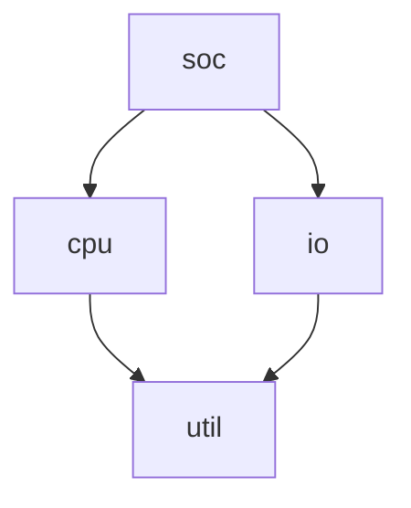

# Тестовая инфраструктура для flow

`coreref.testing` помогает собрать локальную систему пакетов для интеграционного
теста: Conan server, клиентские cache, Git-репозитории и editable workspace.
Тест работает с настоящим SDK; заглушки сервера или Git писать не требуется.

- [Первый тест](#первый-тест)
- [Дерево пакетов](#дерево-пакетов)
- [Git и новые revisions](#git-и-новые-revisions)
- [Проекты рядом с тестом](#проекты-рядом-с-тестом)
- [Consumer и lockfile](#consumer-и-lockfile)
- [Editable workspace](#editable-workspace)
- [Готовые pytest-фикстуры](#готовые-pytest-фикстуры)
- [Счётчики и диагностика](#счётчики-и-диагностика)
- [Только локальный сервер](#только-локальный-сервер)

## Установка и устройство окружения

Установите CoreRef с дополнением `[testing]` в окружение зависимого flow. Для
локального checkout, например:

```sh
python -m pip install -e "../CoreRef[testing]"
```

Путь замените на расположение своего checkout. Дополнение включает pytest,
conan-server и Dulwich. Нужны Python 3.10+ и Git в PATH для SCM-команд Conan;
Docker и внешний Git-сервер не требуются.

`with environment(root) as env:` запускает сервер со случайным портом и предоставляет
`Sandbox`. Каждому тесту передавайте отдельный каталог, например pytest `tmp_path`.

| Объект или метод | Назначение |
|---|---|
| `env.catalog` | Один лениво настроенный каталог с отдельным Conan home |
| `env.new_catalog()` | Дополнительный клиент с новым пустым cache, тот же сервер |
| `env.ref("cpu")` | Координаты `<namespace>.cpu.rtl.default/1.0`; поля можно переопределить |
| `env.package(...)` | Локальная запись с исходниками и/или файлами |
| `env.publish(...)`, `env.publish_set(...)` | Публикация одной записи или связанного набора |
| `env.project(...)` | Consumer со стандартным `manifest.yml` |
| `env.load_projects(...)` | Рабочая копия обычного дерева проектов |
| `env.workspace(directory=...)` | Инициализированный Conan workspace в выбранной директории |

Публикация и workspace используют общий `env.catalog`. Подготовка пакетов и YAML
не создаёт клиента. Отдельный `new_catalog()` нужен, когда тест должен проверить
получение пакета с сервера в пустой cache.

Сервер останавливается при выходе из контекста, включая исключения. Файлы остаются
в переданной директории; их уборкой управляет вызывающий код или pytest.
Пользовательские cache, профили, remotes и credentials не меняются. Окружение
само не переключает cwd и переменные процесса. В pytest-плагине дополнительно
сбрасываются `CONAN_DEFAULT_PROFILE` и `CONAN_DEFAULT_BUILD_PROFILE` на время теста.

## Первый тест

Пакет может содержать SCM-исходники, упакованные файлы или оба вида данных.
В этом примере публикация и получение выполняются разными клиентами.

```python
from pathlib import Path

from coreref.testing import environment


def test_package_roundtrip(tmp_path: Path) -> None:
    with environment(tmp_path / "infra", namespace="demo") as env:
        local = env.package(
            env.ref("cpu"),
            sources={"rtl/cpu.sv": "module cpu; endmodule\n"},
            files={"report.txt": "passed"},
        )
        published = env.publish(local)

        # Новый клиент получает файлы с сервера, исходники — из Git upstream.
        reader = env.new_catalog()
        installed = reader.get_with_sources(published.ref)
        assert installed.source is not None
        assert (installed.source / "rtl/cpu.sv").is_file()
        assert installed.files["report.txt"].read_text() == "passed"
```

`sources={...}` создаёт Git-checkout с коммитом и отдельным bare origin на локальной
файловой системе. Conan сохраняет SCM-координаты и получает исходники из этого
origin. `files={...}` создаёт упаковываемые файлы. Значениями могут быть строки,
bytes или `FixtureFile(content, mode=0o755)` для исполняемого файла.

Без `sources` или `source` пакет не получает Git-репозиторий. Например,
`env.package(env.ref("cpu", view="be", type="lib-lef"), files={...})` готовит пакет
артефактов без SCM. Пользовательские данные задаются обычным `local.payload`.

`package(ref, source=existing_directory)` оборачивает готовые исходники, сохраняя
их Git-состояние; origin и нужный коммит должны быть подготовлены вызывающим кодом.
`source` и `sources` одновременно не задаются. Повторное inline-создание пакета
использует отдельные директории и не перезаписывает предыдущие входы.

## Дерево пакетов



```python
from pathlib import Path

from coreref.api.graph import Graph
from coreref.testing import environment


def test_dependency_tree(tmp_path: Path) -> None:
    links = {"soc": ("cpu", "io"), "cpu": ("util",), "io": ("util",), "util": ()}
    with environment(tmp_path / "infra", namespace="demo") as env:
        records = {
            name: env.package(env.ref(name), sources={f"{name}.sv": f"module {name}; endmodule\n"})
            for name in links
        }
        # Публикация сама вычисляет порядок, хотя soc стоит первым.
        published = env.publish_set(records, dependencies=links)
        graph = Graph(env.new_catalog(), published["soc"].ref)
        installed = graph.get_with_sources()
        assert {record.ref.component for record in installed} == {"soc", "cpu", "io", "util"}
```

Ключи `records` и строки в `links` — короткие имена только для этого набора.
`Ref` у каждой записи остаётся полноценным адресом пакета. Общая зависимость
`util` представлена одним узлом графа.

`publish_set()` проверяет неизвестные имена и циклы до публикации. Возвращает
опубликованные записи по исходным ключам. Значения зависимостей могут также
содержать точные `Ref` ранее опубликованных пакетов. Для инкрементальных сценариев
есть `env.publish(record, dependencies=(published.ref, ...))`; готовый локальный
`Graph` можно передать как `env.publish(graph)`.

Публикация набора не является транзакцией: при сбое Conan ранее опубликованные
пакеты остаются на сервере.

## Git и новые revisions

Можно изменить исходники и повторно опубликовать тот же логический Ref.
Следующий тест проверяет получение обеих точных revisions рецепта.

```python
from pathlib import Path

from coreref.testing import environment, git_commit


def test_new_git_revision(tmp_path: Path) -> None:
    with environment(tmp_path / "infra") as env:
        local = env.package(env.ref("cpu"), sources={"cpu.sv": "first version"})
        first = env.publish(local)
        assert local.source is not None

        # Коммит и push в локальный bare origin; исходная версия остаётся доступна.
        git_commit(local.source, {"cpu.sv": "second version"}, push=True)
        second = env.publish(local)
        assert first.ref != second.ref

        reader = env.new_catalog()
        for published, expected in ((first, "first version"), (second, "second version")):
            installed = reader.get_with_sources(published.ref)
            assert installed.source is not None
            assert (installed.source / "cpu.sv").read_text() == expected
```

Для собственной раскладки доступны `git_repository(directory, files)` и
`git_upstream(checkout, origin_directory)`. Первый может инициализировать обычную
существующую директорию; существующий Git-репозиторий требует явного `reuse=True`.
Второй создаёт новый bare origin и связывает с ним checkout.

`git_commit(directory, push=True)` без словаря файлов коммитит текущие изменения
на диске с учётом `.gitignore`. Можно задать `message` и `author`; helper не
использует глобальный Git identity и не сбрасывает историю. Bare origin не требует
сохранения рабочего checkout после публикации.

## Проекты рядом с тестом

Большие сценарии удобно хранить обычными директориями. Inline-создание пакетов
при этом остаётся доступным; оба способа можно смешивать.

```text
tests/
├── test_flow.py
└── test_projects/
    ├── soc/
    │   ├── manifest.yml
    │   └── rtl/soc.sv
    ├── cpu/
    │   ├── manifest.yml
    │   └── rtl/cpu.sv
    └── stdlib/
        ├── manifest.yml
        └── rtl/stdlib.sv
```

В `stdlib/manifest.yml` достаточно:

```yaml
ref: demo.stdlib.rtl.default/1.0
```

В `cpu/manifest.yml`:

```yaml
ref: demo.cpu.rtl.default/1.0
dependencies:
  - demo.stdlib.rtl.default/1.0
```

В `soc/manifest.yml`:

```yaml
ref: demo.soc.rtl.default/1.0
dependencies:
  - demo.cpu.rtl.default/1.0
```

Тест копирует дерево и подготавливает Git только для публикуемых проектов:

```python
from pathlib import Path

from coreref.testing import environment
from coreref.tools.manifest import ManifestFile


def test_projects_from_directories(tmp_path: Path) -> None:
    projects = Path(__file__).with_name("test_projects")
    with environment(tmp_path / "infra", projects=projects, repositories=("stdlib", "cpu")) as env:
        # Flow выбирает порядок и читает собственный формат проекта.
        for name in ("stdlib", "cpu"):
            manifest = ManifestFile(env.projects / name / "manifest.yml")
            env.publish(manifest.record, dependencies=manifest.dependencies)

        consumer = ManifestFile(env.projects / "soc/manifest.yml")
        installed = consumer.resolve(env.catalog).get_with_sources()
        assert {record.ref.component for record in installed} == {"cpu", "stdlib"}
```

`env.projects` — отдельная рабочая копия дерева. Исходные файлы не меняются;
существующая рабочая копия не перезаписывается. Выбранные `repositories` получают
новые Git-репозитории с bare upstream, остальные директории остаются без Git.
Сохраняются executable-биты и внутренние symlinks; внешние ссылки отклоняются,
Git-метаданные исходного дерева не копируются.

Загрузка дерева не разбирает манифесты и ничего не публикует автоматически.
`ManifestFile` здесь лишь пример: flow может использовать свой YAML, TOML, JSON
или создавать `LocalRecord` напрямую. Для уже созданного окружения есть
`env.load_projects(projects, repositories=(...))`.

## Consumer и lockfile

`env.project()` создаёт стандартный манифест с зависимостями. Запись принадлежит
локальному consumer; публикация самого consumer для разрешения графа не нужна.

```python
from pathlib import Path

from coreref.testing import environment


def test_project_lockfile(tmp_path: Path) -> None:
    with environment(tmp_path / "infra") as env:
        local = env.package(env.ref("cpu"), files={"result.txt": "first"})
        first = env.publish(local)
        project = env.project(
            env.ref("soc"), path=tmp_path / "soc/manifest.yml", dependencies=(local.ref,)
        )
        # Явное действие подготовки теста; обычный resolve не обновляет lockfile.
        project.create_lockfile(env.catalog)
        local.files["result.txt"].write_text("second")
        second = env.publish(local)
        assert first.ref != second.ref

        graph = project.resolve(env.new_catalog())
        assert graph.requirements == (first.ref,)
        assert graph.get()[0].files["result.txt"].read_text() == "first"
```

`project.add(ref)`, `remove(ref)` и `save()` работают как у обычного `ManifestFile`.
`manifest.yml` соответствует `manifest.lock`; создание и обновление lockfile —
отдельное действие через `create_lockfile(catalog)`. SDK передаёт файл Conan,
не разбирая его JSON. Для собственного формата используйте `Graph` и его
`create_lockfile(path)` непосредственно.

У записи из стандартного манифеста `source` по умолчанию указывает на его директорию.
Если consumer нужно опубликовать без SCM, flow явно задаёт `project.record.source = None`.
Для публикации с SCM директория должна быть подготовленным Git-репозиторием.

## Editable workspace

Располагайте workspace в проекте или над ним и запускайте разрешение графа из
его области: Conan обнаруживает workspace по cwd, а не по пути манифеста.

```python
from pathlib import Path

import pytest

from coreref.testing import environment


def test_editable_dependency(tmp_path: Path, monkeypatch: pytest.MonkeyPatch) -> None:
    with environment(tmp_path / "infra") as env:
        local = env.package(env.ref("cpu"), sources={"cpu.sv": "published RTL"})
        published = env.publish(local)
        project = env.project(
            env.ref("soc"), path=tmp_path / "soc/manifest.yml", dependencies=(local.ref,)
        )
        workspace = env.workspace(directory=project.path.parent)
        checkout = workspace.open(published.ref, directory=tmp_path / "editable/cpu")
        (checkout / "cpu.sv").write_text("working RTL")

        # Workspace лежит в soc/, а editable checkout может быть рядом с проектом.
        monkeypatch.chdir(project.path.parent)
        installed = project.resolve(env.catalog).get_with_sources()[0]
        assert installed.is_editable and installed.source == checkout
        assert (checkout / "cpu.sv").read_text() == "working RTL"
```

`env.workspace(directory=...)` использует общий каталог и создаёт нативные
`conanws.yml` и `conanws.py`. `open(ref)` получает Git-копию выбранного пакета,
добавляет рецепт и регистрирует её. Манифест consumer не изменяется: пакет должен
встречаться в его дереве зависимостей, чтобы рабочая копия использовалась в графе.

Для уже существующего checkout используйте `workspace.add(directory, record=local,
dependencies=(...))`. Для стандартного YAML —
`ManifestFile(path).add_to_workspace(workspace)`. Git для регистрации готовой
директории не обязателен. `workspace.remove(directory)` снимает регистрацию,
сохраняя файлы. После изменения состава workspace создавайте новый `Graph`.

## Готовые pytest-фикстуры

Плагин необязателен: все предыдущие примеры работают без него. Для готовых фикстур
добавьте в `tests/conftest.py`:

```python
# tests/conftest.py
from __future__ import annotations

from pathlib import Path
from typing import TYPE_CHECKING

import pytest

if TYPE_CHECKING:
    from coreref.testing.pytest_plugin import EnvironmentOptions

pytest_plugins = ["coreref.testing.pytest_plugin"]


@pytest.fixture
def coreref_options() -> EnvironmentOptions:
    return {
        "projects": Path("tests/test_projects"),
        "repositories": ("stdlib", "cpu"),
        "namespace": "demo",
    }
```

`coreref_options` возвращает обычный словарь; `EnvironmentOptions` — только его
описание типов. Все поля необязательны. По умолчанию проекты не копируются,
repositories пуст, namespace — `test`, timeout HTTP-запроса — 5 секунд.
Параметр `repositories` требует `projects`. Относительный `projects` считается
от корня pytest (`config.rootpath`), абсолютный путь также допустим.

| Фикстура | Значение |
|---|---|
| `coreref_environment` | Отдельный `Sandbox` и сервер на один тест |
| `coreref_catalog` | Тот же объект, что `coreref_environment.catalog` |
| `coreref_server` | Сервер окружения, включая stop/start/restart |
| `coreref_project` | Consumer с манифестом `tmp_path/manifest.yml` |

Пример теста для конфигурации выше:

```python
from coreref.api.catalog import Catalog
from coreref.testing import Sandbox
from coreref.tools.manifest import ManifestFile


def test_flow_fixtures(coreref_environment: Sandbox, coreref_catalog: Catalog) -> None:
    env = coreref_environment
    manifest = ManifestFile(env.projects / "stdlib/manifest.yml")
    published = env.publish(manifest.record)
    assert coreref_catalog is env.catalog
    assert coreref_catalog.info(published.ref).ref == published.ref
```

Словарь настроек не меняется плагином; фикстуру можно сделать session-scoped.
Само окружение остаётся отдельным для каждого теста. Для разных сценариев
параметризуйте `coreref_options` обычным `@pytest.fixture(params=...)` или
переопределите её в модуле. CoreRef не регистрирует и не читает pytest-маркеры:
группировку и отбор тестов задаёт сам flow. Collection-хуки для настроек не нужны.
Создание только `coreref_project` не инициализирует Conan-клиент.

## Счётчики и диагностика

`trace_operations()` помогает проверить отсутствие лишних команд и скачиваний.
Для измерений времени предназначена [отдельная группа performance](development.md#производительность-sdk).

```python
from pathlib import Path

from coreref.api.graph import Graph
from coreref.testing import environment, trace_operations


def test_fetch_counts(tmp_path: Path) -> None:
    with environment(tmp_path / "infra") as env:
        published = env.publish(env.package(env.ref("cpu"), sources={"cpu.sv": "RTL"}))
        graph = Graph(env.new_catalog(), published.ref)

        with trace_operations() as fetched:
            graph.get_with_sources()
        assert fetched.installs == 1
        assert fetched.source_clones == 1

        with trace_operations() as cached:
            graph.get_with_sources()
        assert cached.commands == ()
```

Доступны `commands`, `installs`, `recipe_reads`, `recipe_downloads`,
`package_downloads`, `source_clones`. Команды, чтения и clone считаются как попытки;
скачивания — успешные GET архивов рецепта или бинарного пакета. Разрешение графа
также может скачивать рецепты.

Инструментация действует на весь Python-процесс, включая другие каталоги;
используйте её последовательно, без вложенных контекстов и параллельных операций.
Счётчики сохраняются после выхода, перехваченные методы восстанавливаются и при
исключении. Это функциональная проверка операций, не замер времени.

Отказы сервера также можно воспроизвести без заглушек:

```python
from pathlib import Path

import pytest

from coreref.api.errors import CatalogError
from coreref.api.query import SearchQuery
from coreref.testing import environment


def test_server_recovery(tmp_path: Path) -> None:
    with environment(tmp_path / "infra", namespace="demo", timeout=0.2) as env:
        published = env.publish(env.package(env.ref("cpu")))
        env.server.stop()
        with pytest.raises(CatalogError):
            env.catalog.search_refs(SearchQuery(namespace="demo"))
        env.server.start()
        assert env.catalog.search_refs(SearchQuery(namespace="demo")) == (published.ref,)
```

`stop()` и `start()` идемпотентны. `restart()` сохраняет URL, credentials и данные
реестра. Timeout относится к одному HTTP-запросу, не ко всей операции SDK.

`env.diagnostics()` возвращает пути проектов и Conan home, server log и успешно
опубликованные Ref без сетевых запросов или пароля. Плагин добавляет эту информацию
в отчёт pytest при ошибках setup, теста и teardown, если окружение уже создано.
При использовании `environment()` напрямую диагностику можно вывести самостоятельно.

## Только локальный сервер

Если flow уже имеет собственные фикстуры проектов и клиентов, достаточно
`local_server()` и `server.configure(home)`:

```python
from pathlib import Path

from coreref.api.catalog import Catalog
from coreref.api.query import SearchQuery
from coreref.testing import local_server


def test_server_only(tmp_path: Path) -> None:
    with local_server(tmp_path / "server") as server:
        catalog = Catalog(server.configure(tmp_path / "client"))
        assert catalog.search_refs(SearchQuery()) == ()
```

`configure()` готовит профиль через нативное определение Conan, remote и авторизацию.
Локальные Git URL разрешены по умолчанию; для явного запрета есть
`local_sources=False`. `configured_home(home)` подготавливает отдельный cache без
активных публичных remotes и без собственного сервера. Если сервер уже запущен,
`Sandbox(server, root)` предоставляет те же builders без владения его временем жизни.

Полные контракты записей, графа и workspace описаны в [публичном API](interfaces.md).
