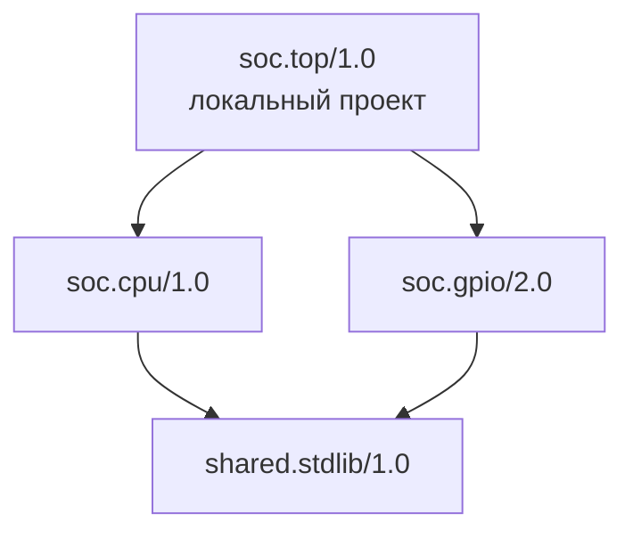
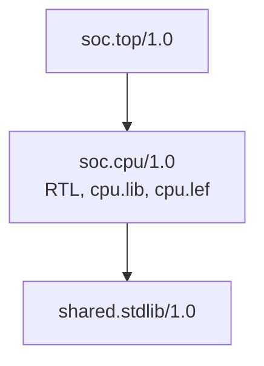

# Примеры использования

## Принцип работы

Ref задаёт координаты компонента или библиотеки, например `soc.cpu/1.0` или
`shared.stdlib/2.0`. Опубликованная ревизия объединяет исходники и готовые
артефакты. Flow использует из неё входы нужной стадии.

В примерах `Manifest` читает стандартный YAML, а `Project` связывает его с рабочей
директорией, каталогом и lockfile.

Graph строится и для неопубликованного локального проекта. Его lockfile сохраняют
в репозитории или workspace проекта для повторения выбора версий и revisions.
Для работы над зависимостью используют `workspace.open(ref)` или
`workspace.add(directory, record=local_record, dependencies=refs)`. По манифесту
рабочая копия добавляется командой `flow workspace add`.
Conan сам выбирает рабочие копии из workspace текущего проекта; Graph не требует
особых параметров. SDK добавляет в рабочую копию только conanfile.py, если его ещё нет.
`InstalledRecord.is_editable` отличает такую запись от кэшовой. Локальные files могут
быть созданы позднее; source указывает на рабочие исходники.

Ниже три сценария работы с одним пакетом компонента: получение RTL и LIB/LEF,
а также публикация артефактов маршрута по мере их готовности.

## RTL-проект: зависимости и исходники

Вариант использования вместо Bender: приложение читает manifest.yml,
SDK разрешает дерево и получает исходники, приложение собирает список RTL-файлов.
Поле payload.sources в этом примере — соглашение приложения.
Все RTL-зависимости уже опубликованы с таким списком и SCM-исходниками.



Стрелка направлена от потребителя к зависимости. Здесь stdlib — пример общей
транзитивной зависимости CPU и GPIO: в manifest.yml корня достаточно указать эти два блока,
а stdlib попадёт в разрешённый граф и список исходников один раз.

```yaml
# manifest.yml в корне Git-проекта
ref: soc.top/1.0
payload:
  sources: [rtl/top.sv]
dependencies:
  - soc.cpu/1.0
  - soc.gpio/2.0
```

```python
from pathlib import Path

from coreref.api.build import Outputs
from coreref.api.packages import Catalog, InstalledRecord, LocalRecord, Record, Ref
from coreref.api.projects import Graph, Manifest, Project


def resolve_rtl_project(catalog: Catalog, root: Path) -> Graph:
    """Прочитать YAML и учесть существующий manifest.lock, не изменяя его."""
    manifest = Manifest.load(root / "manifest.yml")
    return Project(root, manifest, catalog).graph


def collect_rtl_sources(graph: Graph) -> list[Path]:
    """Получить зависимости одной группой и добавить исходники локального корня."""
    records = (*graph.dependencies(transitive=True), graph.record)
    directories = graph.get_sources(
        tuple(record.ref for record in records if isinstance(record, Record))
    )
    sources = []
    for record in records:
        directory = (
            record.source if isinstance(record, LocalRecord) else directories.get(record.ref)
        )
        if directory is not None:
            # sources в payload — относительные пути по соглашению приложения.
            sources.extend(directory / name for name in record.payload["sources"])
    return sources


catalog = Catalog()
graph = resolve_rtl_project(catalog, Path.cwd())
sources = collect_rtl_sources(graph)
```

`sources` содержит пути в порядке «зависимости перед потребителем».
Локальный top остаётся в рабочем дереве, зависимости получаются одной пакетной операцией.
Существующий lockfile используется при разрешении и остаётся без изменений.
Чтобы явно сохранить выбор, вызывают `graph.create_lockfile(Path.cwd() / "manifest.lock")`;
этот вызов создаёт или перезаписывает файл снимком текущего Graph.
Для намеренного обновления зависимостей создают новый Graph без старого lockfile,
затем явно сохраняют новый выбор. Lockfile хранят в репозитории.

При готовности к публикации вызывают `catalog.publish(graph)`
из чистого Git checkout с доступным получателям remote.
Для уже опубликованного корня достаточно `Graph(catalog, Ref(...))`.

## Получить LIB/LEF из пакета компонента

В том же графе `soc.top` flow получает физические файлы уже выбранной ревизии CPU.
Эта ревизия должна содержать нужные файлы. Правила их именования задаёт производящий flow.



```python
def macro_files(catalog: Catalog, graph: Graph, ref: Ref) -> tuple[Path, Path]:
    macro = graph.info(ref)
    if not isinstance(macro, Record):
        raise ValueError("Expected a published macro")
    files = Outputs(catalog).get(macro, ("cpu.lib", "cpu.lef"))
    return files["cpu.lib"], files["cpu.lef"]


lib, lef = macro_files(catalog, graph, Ref("soc.cpu/1.0"))
```

Точный выбор берётся из графа проекта. Если его ревизия CPU содержит только RTL,
flow может попросить обновить lockfile до выпуска с LIB/LEF. Симуляция может
продолжать использовать закреплённый RTL.

## Публиковать результаты по мере готовности

Первый выпуск CPU может содержать только RTL из SCM. Позднее flow публикует
срез с netlist. Когда появляются входы для физической реализации, следующий
срез включает Liberty, LEF и GDS. Flow реализует этот маршрут в своём подклассе
`Project`.

```python
def publish_cpu(project: Project, through: str) -> InstalledRecord:
    """Собрать стадию с её предшественниками и опубликовать выходы."""
    return project.publish(through)
```

В CI команда может вызвать `project.publish()`, чтобы SDK выбрал готовые стадии
по правилам flow. CoreRef вычисляет идентификатор среза и публикует файлы по
отдельности. Оглавление закрепляет их за ревизией проекта, поэтому потребитель
может загрузить только нужные выходы.
