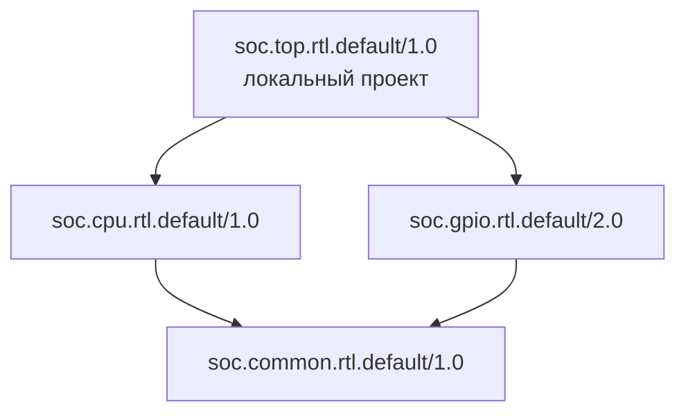
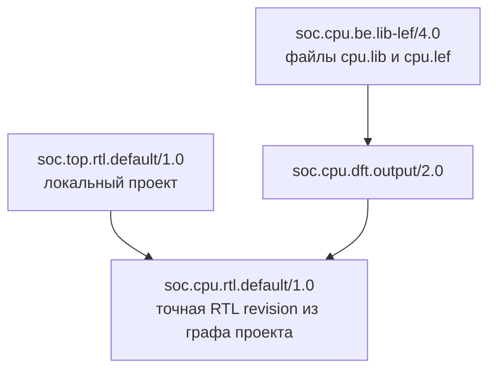

# Два примера

## RTL-проект: зависимости и исходники

Вариант использования вместо Bender: приложение читает свой deps.toml,
SDK разрешает дерево и получает исходники, приложение собирает список RTL-файлов.
Формат TOML и поле payload.sources в этом примере — соглашение приложения.
Все RTL-зависимости уже опубликованы с таким списком и SCM-исходниками.



Стрелка направлена от потребителя к зависимости. Здесь common — пример общей
транзитивной зависимости CPU и GPIO: в deps.toml корня достаточно указать эти два блока,
а common попадёт в разрешённый граф и список исходников один раз.

```toml
# deps.toml в корне Git-проекта
ref = "soc.top.rtl.default/1.0"
sources = ["rtl/top.sv"]
dependencies = ["soc.cpu.rtl.default/1.0", "soc.gpio.rtl.default/2.0"]
```

```python
import tomllib
from pathlib import Path

from hwcatalog.api.catalog import Catalog
from hwcatalog.api.graph import Graph
from hwcatalog.api.records import LocalRecord, Ref

catalog = Catalog()
root = Path.cwd()
config = tomllib.loads((root / "deps.toml").read_text())
local = LocalRecord(
    Ref(config["ref"], catalog=catalog),
    payload={"sources": config["sources"]},
    source=root,
)
dependencies = tuple(Ref(value, catalog=catalog) for value in config["dependencies"])
lock = root / "conan.lock"
graph = Graph(catalog, local, dependencies=dependencies, lockfile=lock if lock.exists() else None)

sources = []
for package in graph.get_with_sources():
    if package.source is not None:
        sources.extend(package.source / name for name in package.payload["sources"])
sources.extend(root / name for name in config["sources"])
graph.create_lockfile(lock)
```

`sources` содержит пути в порядке «зависимости перед потребителем».
Локальный top остаётся в рабочем дереве, зависимости получаются одной пакетной операцией.
Lockfile сохраняют в репозитории для повторения выбора. При готовности к публикации
вызывают `catalog.publish(graph)` из чистого Git checkout с доступным получателям remote.
Для уже опубликованного корня достаточно `Ref(..., catalog=catalog).graph()`.

## Найти LIB/LEF для выбранного RTL

Продолжение примера: выбрать BE-представление CPU из реестра.
Имя пакета находит кандидатов, зависимость от точной RTL revision подтверждает происхождение.
У кандидатов могут быть промежуточные DFT-узлы.



BE-кандидат хранит зависимость через DFT от той же RTL revision, которую выбрал
проект. Для BE без DFT связь может быть прямой: BE → RTL.

```python
from hwcatalog.api.query import SearchQuery

rtl = graph.info(Ref("soc.cpu.rtl.default/1.0", catalog=catalog)).ref
query = SearchQuery.for_component(rtl, view="be", type="lib-lef")
matching = []
for candidate in catalog.search_refs(query):
    be_graph = candidate.graph()
    if rtl in be_graph.ordered_refs(be_graph.record.ref):
        matching.append(be_graph)
if len(matching) != 1:
    raise ValueError("Нужно выбрать одну BE-реализацию: уточните version или revision")

be_graph = matching[0]
be = be_graph.get((be_graph.record.ref,))[0]
lib, lef = be.files["cpu.lib"], be.files["cpu.lef"]
```

Пример предполагает LIB/LEF внутри пакета. Если flow хранит их на NFS,
он читает пути из собственной схемы `be.payload` и проверяет их доступность.
Версия BE может отличаться от версии RTL. Поиск берёт последние BE revisions;
историческую выбирают явно, а не подставляют автоматически при несовпадении RTL.

Для исключения заменённой RTL-ветви из списка исходников используют
`graph.ordered_refs(graph.record.ref, stop_at=(rtl,))`, исключают сам rtl и передают
оставшиеся опубликованные Ref в `graph.get_with_sources(refs)`. Общие зависимости
других ветвей сохраняются. Выбор замены и использование LIB/LEF остаются логикой flow.
