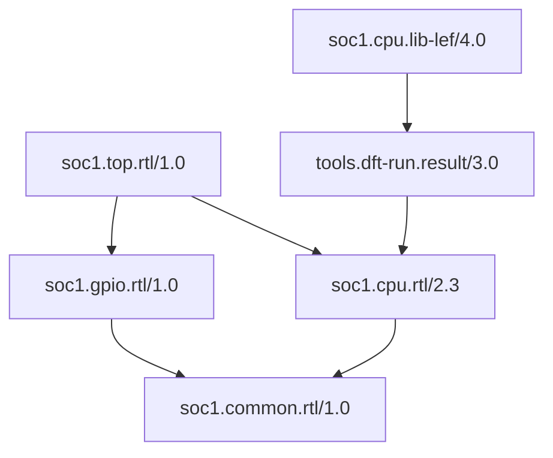

# Сценарии

Каталог хранит неизменяемые Record с точными версиями и зависимостями. Он позволяет
публиковать компоненты, получать состав проекта и искать представления по координатам.

## RTL → LIB/LEF

1. Получить `catalog.graph.dependency_closure(top_ref)` и выбрать RTL-компоненты.
2. Для выбранного RTL вызвать `catalog.find_dependents(rtl_ref,
   candidates=SearchQuery(namespace="soc1", name="cpu", kind="lib-lef"))`.
3. Из найденных кандидатов приложение выбирает нужную реализацию и читает payload
   с метаданными. Файлы из Conan получают через `catalog.materialize(ref)`,
   внешние ресурсы — через `LocatedResource`.
4. Приложение исключает заменённые RTL-ветки из собственных входов, сохраняя общие
   зависимости остальных блоков, подготавливает ресурсы и запускает инструмент.

Направление стрелки — от пакета к его зависимости. Имя BE определяет представление;
наличие точного CPU в его графе подтверждает связь с выбранным RTL. Версии CPU и BE
могут различаться. Промежуточный DFT-узел не обязан иметь те же namespace/name/kind.

Прямой поиск `dependencies(ref)` возвращает Record входов узла, `consumers(ref)` —
непосредственных потребителей. Для собственного анализа GraphResult.to_networkx()
предоставляет DiGraph. Экспорт и обработка выбранного графа не меняют публикации.

Полный исполняемый пример находится в examples/conan_macro.py.
