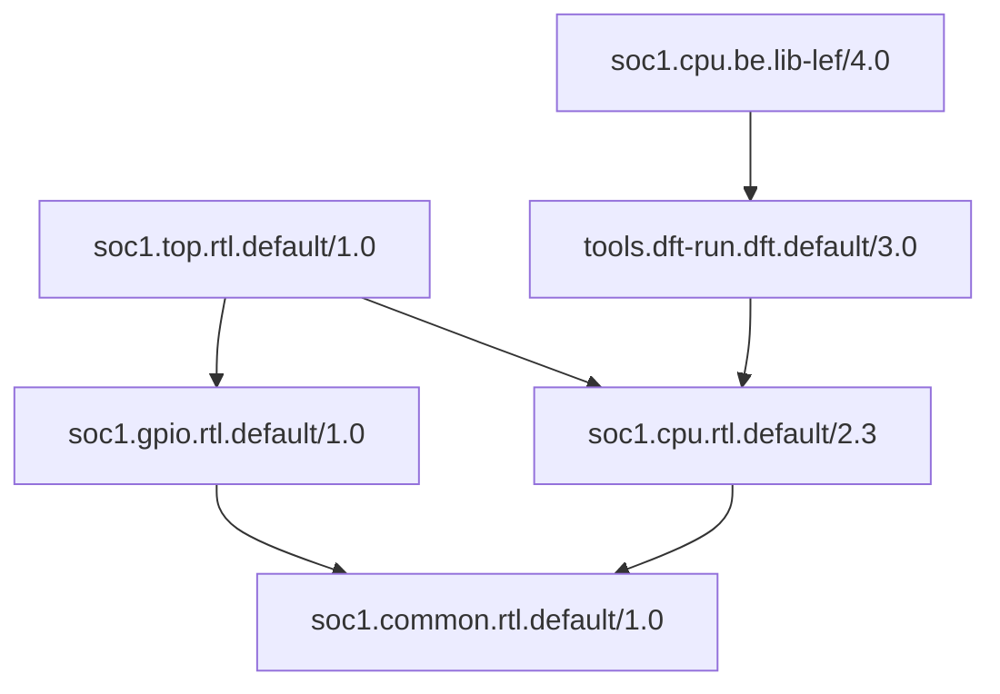

# Сценарии

Каталог хранит неизменяемые Record с точными версиями и зависимостями. Он позволяет
публиковать компоненты, получать состав проекта и искать представления по координатам.

## RTL → LIB/LEF

1. Передать LocalRecord и прямые зависимости в `Graph(catalog, record, dependencies=...).result`
   и выбрать RTL-компоненты из полученного графа. Если исходное описание берётся
   из опубликованного пакета, его читают через `top_ref.get()` и `top_ref.dependencies()`.
2. Для выбранного RTL вызвать `rtl_ref.find_dependents(
   candidates=SearchQuery(namespace="soc1", component="cpu", view="be", type="lib-lef"))`.
3. Из найденных кандидатов приложение выбирает нужную реализацию и читает payload
   с метаданными. Файлы из Conan получают через `ref.get().files`,
   внешние ресурсы flow читает из собственной схемы `record.payload`.
4. Вызвать result.ordered_records(top_ref, stop_at=(rtl_ref,)) и исключить сам
   заменённый RTL из списка исходников. SDK сохраняет общие зависимости остальных
   блоков; flow подготавливает ресурсы BE и запускает инструмент.

Направление стрелки — от пакета к его зависимости. Имя BE определяет представление;
наличие точного CPU в его графе подтверждает связь с выбранным RTL. Версии CPU и BE
могут различаться. Промежуточный DFT-узел не обязан иметь те же namespace/component/view/type.

Прямой поиск `ref.dependencies()` возвращает Record входов узла;
`ref.find_dependents(candidates=SearchQuery(), transitive=False)` — непосредственных
потребителей. Для собственного анализа GraphResult.networkx
предоставляет DiGraph. Экспорт и обработка выбранного графа не меняют публикации.

Полный исполняемый пример находится в examples/conan_macro.py.
