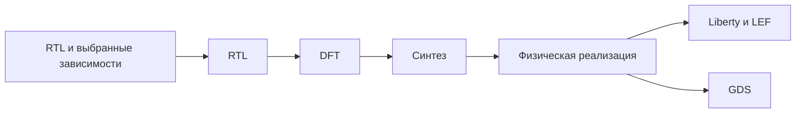

# Маршрут из Python-функций

Flow описывает граф, а CoreRef связывает выходы со входами стадий.



Простейший маршрут можно задать напрямую или сгенерировать объявления и привязки
из YAML через `python -m coreref.api.build.codegen stage-map.yml generated_route.py`.

```python
from functools import cached_property

from coreref.api.build import Route, Stage, StageSpec
from coreref.api.projects import Project


def bundle(work, log, configuration):
    (work / "rtl.v").write_text((work / "source.sv").read_text())


class RtlProject(Project):
    @cached_property
    def route(self):
        return Route([StageSpec(name="rtl", outputs=("rtl.v",))])

    @cached_property
    def stages(self):
        return {"rtl": Stage(transform=bundle, files={"source.sv": self.source / "rtl/top.sv"})}
```

Поместите функцию в импортируемый модуль. Вызов `project.build("rtl")` создаёт
ссылку на результат в `.build/rtl.v`. Изменение входного RTL создаёт новую
derivation. Файлы, которые стадия не читает, в её ключ не входят.

Релиз собирается из чистого Git checkout с существующим `manifest.lock`.
`project.publish()` последовательно копирует результаты и индекс в настроенный
Nix binary cache. Индекс можно зарегистрировать в каталоге потребителя.

```python
from coreref.api.build import Outputs
from coreref.api.packages import Catalog

release = project.publish()
consumer = Catalog(cache=cache, releases={release.ref: release.files["release.json"]})
files = Outputs(consumer).get(consumer.info(release.ref), ("rtl.v",))
```
