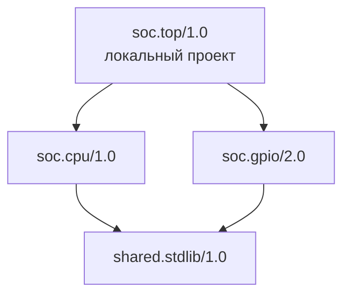
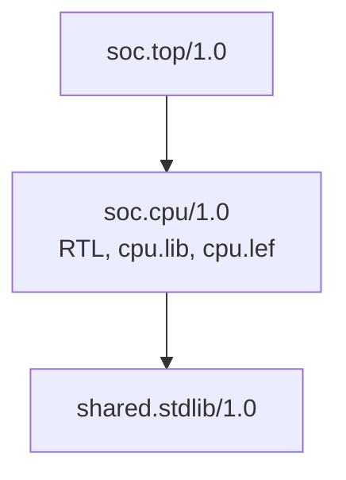

# Примеры использования

## Принцип работы

Ref задаёт координаты компонента или библиотеки, например `soc.cpu/1.0` или
`shared.stdlib/2.0`. Опубликованная ревизия объединяет исходники и готовые
артефакты. Flow использует из неё входы нужной стадии.

В примерах используется необязательный YAML-адаптер `ManifestFile`. Приложение
может читать собственный формат и создавать `LocalRecord` и зависимости напрямую.

Graph строится и для неопубликованного локального проекта. Его lockfile сохраняют
в репозитории или workspace проекта для повторения выбора версий и revisions.
Для работы над зависимостью используют `workspace.open(ref)` или
`workspace.add(directory, record=local_record, dependencies=refs)`. Формат проекта читает flow;
для стандартного YAML есть `ManifestFile.add_to_workspace(workspace)`.
Conan сам выбирает рабочие копии из workspace текущего проекта; Graph не требует
особых параметров. SDK добавляет в рабочую копию только conanfile.py, если его ещё нет.
`InstalledRecord.is_editable` отличает такую запись от кэшовой. Локальные files могут
быть созданы позднее; source указывает на рабочие исходники.

Ниже три сценария работы с одним пакетом компонента: получение RTL и LIB/LEF,
а также публикация артефактов маршрута по мере их готовности.

## RTL-проект: зависимости и исходники

Вариант использования вместо Bender: приложение читает manifest.yml,
SDK разрешает дерево и получает исходники, приложение собирает список RTL-файлов.
Поле payload.sources в этом примере — соглашение приложения.
Все RTL-зависимости уже опубликованы с таким списком и SCM-исходниками.



Стрелка направлена от потребителя к зависимости. Здесь stdlib — пример общей
транзитивной зависимости CPU и GPIO: в manifest.yml корня достаточно указать эти два блока,
а stdlib попадёт в разрешённый граф и список исходников один раз.

```yaml
# manifest.yml в корне Git-проекта
ref: soc.top/1.0
payload:
  sources: [rtl/top.sv]
dependencies:
  - soc.cpu/1.0
  - soc.gpio/2.0
```

```python
from pathlib import Path

from coreref.api.catalog import Catalog
from coreref.tools.manifest import ManifestFile
from coreref.api.graph import Graph
from coreref.api.records import InstalledRecord, LocalRecord, Ref


def resolve_rtl_project(catalog: Catalog, root: Path) -> Graph:
    """Прочитать YAML и учесть существующий manifest.lock, не изменяя его."""
    manifest = ManifestFile(root / "manifest.yml")
    # Стандартный манифест находится в корне проекта; source уже указывает туда.
    return manifest.resolve(catalog)


def collect_rtl_sources(graph: Graph) -> list[Path]:
    """Получить зависимости одной группой и добавить исходники локального корня."""
    records: tuple[LocalRecord | InstalledRecord, ...] = graph.get_with_sources()
    if isinstance(graph.record, LocalRecord):
        records = (*records, graph.record)
    sources = []
    for record in records:
        if record.source is not None:
            # sources в payload — относительные пути по соглашению приложения.
            sources.extend(record.source / name for name in record.payload["sources"])
    return sources


catalog = Catalog()
graph = resolve_rtl_project(catalog, Path.cwd())
sources = collect_rtl_sources(graph)
```

`sources` содержит пути в порядке «зависимости перед потребителем».
Локальный top остаётся в рабочем дереве, зависимости получаются одной пакетной операцией.
Существующий lockfile используется при разрешении и остаётся без изменений.
Чтобы явно сохранить выбор, вызывают `graph.create_lockfile(Path.cwd() / "manifest.lock")`;
этот вызов создаёт или перезаписывает файл снимком текущего Graph.
Для намеренного обновления зависимостей создают новый Graph без старого lockfile,
затем явно сохраняют новый выбор. Lockfile хранят в репозитории.

При готовности к публикации вызывают `catalog.publish(graph)`
из чистого Git checkout с доступным получателям remote.
Для уже опубликованного корня достаточно `Graph(catalog, Ref(...))`.

## Получить LIB/LEF из пакета компонента

В том же графе `soc.top` flow получает физические файлы уже выбранной ревизии CPU.
Эта ревизия должна содержать нужные файлы. Правила их именования задаёт производящий flow.



```python
def macro_files(graph: Graph, ref: Ref) -> tuple[Path, Path]:
    (macro,) = graph.get((ref,))
    return macro.files["cpu.lib"], macro.files["cpu.lef"]


lib, lef = macro_files(graph, Ref("soc.cpu/1.0"))
```

Точный выбор берётся из графа проекта. Если его ревизия CPU содержит только RTL,
flow может попросить обновить lockfile до выпуска с LIB/LEF. Симуляция может
продолжать использовать закреплённый RTL.

## Публиковать результаты по мере готовности

В репозитории CPU маршрут выполняет те стадии, которые зарегистрировал проект.
Первый выпуск может содержать только RTL из SCM. Позднее публикуется ревизия с
netlist, а после физической реализации — с netlist, Liberty, LEF и GDS.

```python
from coreref.tools.route import Route


def publish_cpu(
    catalog: Catalog, manifest: ManifestFile, route: Route, target: str
) -> InstalledRecord:
    graph = manifest.resolve(catalog)
    manifest.record.files.update(route.run(target))
    return catalog.publish(graph)
```

`Route` импортируется из `coreref.tools.route`. Проект определяет стадии,
инструменты и полный набор файлов очередного снимка. Исходники и манифест
относятся к одному проекту. Внешние зависимости фиксируются его lockfile.
`Ref` с revision позволяет получить конкретный опубликованный снимок независимо
от последующих выпусков.
