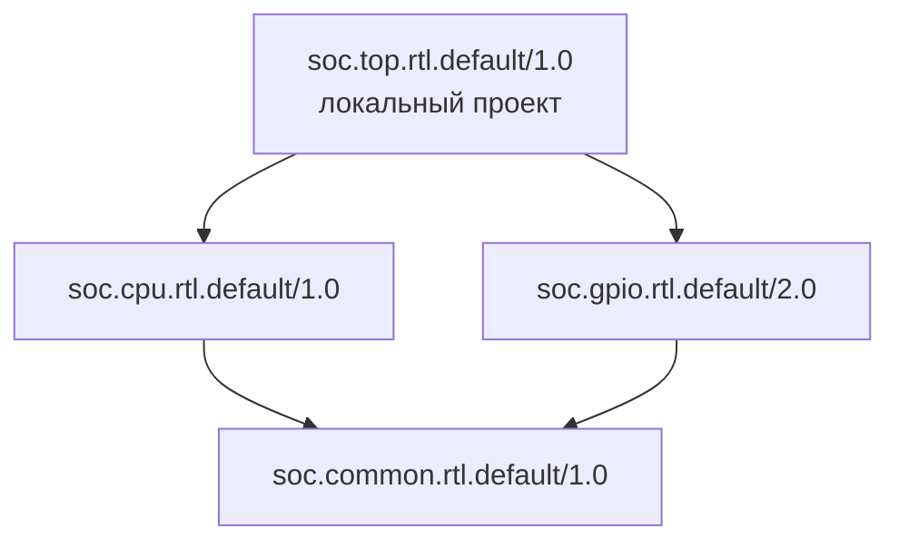
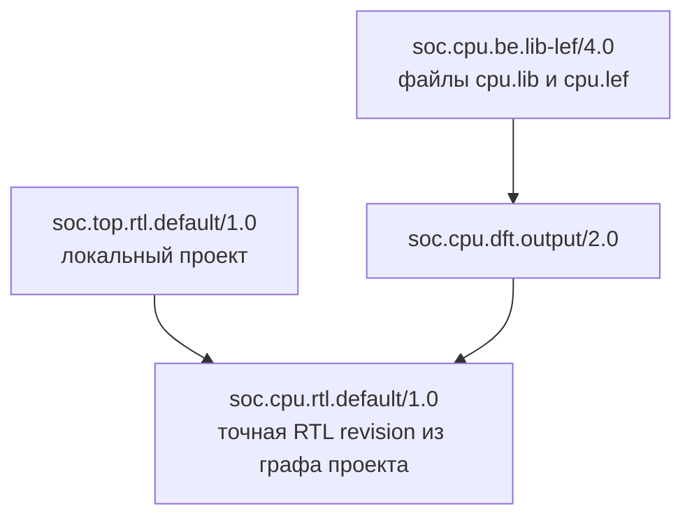
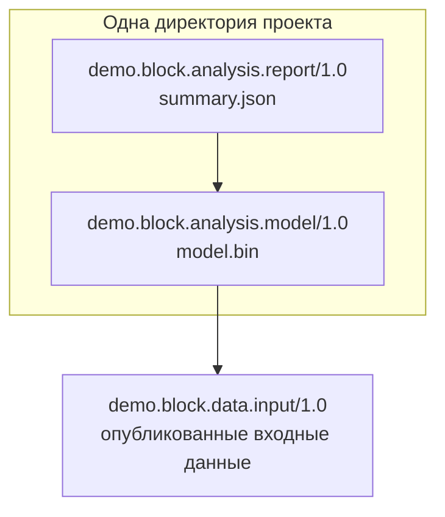

# Примеры использования

## Принцип работы

Ref описывает **какой компонент и в каком представлении** нужен:
`namespace.component[_subcomponent].view.type/version[#revision]`.
Например, у `soc.cpu.rtl.default/1.0` можно искать BE-представления того же
`soc.cpu`, выбирая `view="be"` и `type="lib-lef"`. Их версия независима от версии RTL;
происхождение проверяется по точным зависимостям. Смысл всех полей описан в [API](interfaces.md).

Приложение определяет формат перечисления зависимостей: в примере ниже это TOML,
но SDK принимает уже созданные LocalRecord и Ref. Часть зависимостей может приходить
из файла, часть — из поиска других представлений или правил flow. SDK скрывает
рецепты Conan и предоставляет публикацию, поиск, граф и получение файлов/SCM в Python.

Graph строится и для неопубликованного локального проекта. Его lockfile сохраняют
в репозитории или workspace проекта для повторения выбора версий и revisions.
Для работы над зависимостью используют `workspace.add(ref)`: исходники появляются
в отдельной рабочей Git-копии, Conan регистрирует их в conanws.yml проекта.
Из корня Conan подхватывает workspace автоматически; из другой директории его
можно передать в Graph через `workspace=...`. Служебные файлы остаются untracked.
У editable файлы из `files` указывают на локальную artifacts/ и могут быть созданы позднее.

Ниже три сценария: собрать RTL-исходники, найти LIB/LEF и опубликовать
несколько результатов одного проекта.

## RTL-проект: зависимости и исходники

Вариант использования вместо Bender: приложение читает свой deps.toml,
SDK разрешает дерево и получает исходники, приложение собирает список RTL-файлов.
Формат TOML и поле payload.sources в этом примере — соглашение приложения.
Все RTL-зависимости уже опубликованы с таким списком и SCM-исходниками.



Стрелка направлена от потребителя к зависимости. Здесь common — пример общей
транзитивной зависимости CPU и GPIO: в deps.toml корня достаточно указать эти два блока,
а common попадёт в разрешённый граф и список исходников один раз.

```toml
# deps.toml в корне Git-проекта
ref = "soc.top.rtl.default/1.0"
sources = ["rtl/top.sv"]
dependencies = ["soc.cpu.rtl.default/1.0", "soc.gpio.rtl.default/2.0"]
```

```python
import tomllib
from pathlib import Path

from coreref.api.catalog import Catalog
from coreref.api.graph import Graph
from coreref.api.records import InstalledRecord, LocalRecord, Ref


def resolve_rtl_project(catalog: Catalog, root: Path) -> Graph:
    """Прочитать описание приложения и разрешить зависимости локального проекта."""
    config = tomllib.loads((root / "deps.toml").read_text())
    local = LocalRecord(
        Ref(config["ref"], catalog=catalog),
        payload={"sources": config["sources"]},
        source=root,
    )
    dependencies = tuple(Ref(value, catalog=catalog) for value in config["dependencies"])
    lockfile = root / "conan.lock"
    # Существующий lockfile ограничивает выбор; сохранение выполняется отдельно.
    return Graph(
        catalog,
        local,
        dependencies=dependencies,
        lockfile=lockfile if lockfile.exists() else None,
    )


def collect_rtl_sources(graph: Graph) -> list[Path]:
    """Получить зависимости одной группой и добавить исходники локального корня."""
    records: tuple[LocalRecord | InstalledRecord, ...] = graph.get_with_sources()
    if isinstance(graph.record, LocalRecord):
        records = (*records, graph.record)
    sources = []
    for record in records:
        if record.source is not None:
            # sources в payload — относительные пути по соглашению приложения.
            sources.extend(record.source / name for name in record.payload["sources"])
    return sources


catalog = Catalog()
graph = resolve_rtl_project(catalog, Path.cwd())
sources = collect_rtl_sources(graph)
```

`sources` содержит пути в порядке «зависимости перед потребителем».
Локальный top остаётся в рабочем дереве, зависимости получаются одной пакетной операцией.
Существующий lockfile используется при разрешении и остаётся без изменений.
Чтобы явно сохранить выбор, вызывают `graph.create_lockfile(Path.cwd() / "conan.lock")`;
этот вызов создаёт или перезаписывает файл снимком текущего Graph.
Для намеренного обновления зависимостей создают новый Graph без старого lockfile,
затем явно сохраняют новый выбор. Lockfile хранят в репозитории.

При готовности к публикации вызывают `catalog.publish(graph)`
из чистого Git checkout с доступным получателям remote.
Для уже опубликованного корня достаточно `Ref(..., catalog=catalog).graph()`.

## Найти LIB/LEF для выбранного RTL

Продолжение примера: выбрать BE-представление CPU из реестра.
Имя пакета находит кандидатов, зависимость от точной RTL revision подтверждает происхождение.
У кандидатов могут быть промежуточные DFT-узлы.



BE-кандидат хранит зависимость через DFT от той же RTL revision, которую выбрал
проект. Для BE без DFT связь может быть прямой: BE → RTL.

```python
from coreref.api.catalog import Catalog
from coreref.api.graph import Graph
from coreref.api.query import SearchQuery
from coreref.api.records import InstalledRecord, Ref


def find_lib_lef(catalog: Catalog, rtl: Ref) -> InstalledRecord:
    """Найти единственное BE-представление точной RTL revision и получить файлы пакета."""
    query = SearchQuery.for_component(rtl, view="be", type="lib-lef")
    matching: list[Graph] = []
    for candidate in catalog.search_refs(query):
        be_graph = candidate.graph()
        # Координаты находят кандидатов; граф подтверждает происхождение от RTL.
        if rtl in be_graph.ordered_refs(be_graph.record.ref):
            matching.append(be_graph)
    if len(matching) != 1:
        raise ValueError("Нужно выбрать одну BE-реализацию: уточните version или revision")
    selected = matching[0]
    return selected.get((selected.record.ref,))[0]


# Берём revision CPU из уже разрешённого проекта первого примера.
rtl = graph.info(Ref("soc.cpu.rtl.default/1.0", catalog=catalog)).ref
be = find_lib_lef(catalog, rtl)
lib, lef = be.files["cpu.lib"], be.files["cpu.lef"]
```

Пример предполагает LIB/LEF внутри пакета. Если flow хранит их на NFS,
он читает пути из собственной схемы `be.payload` и проверяет их доступность.
Версия BE может отличаться от версии RTL. Поиск берёт последние BE revisions;
историческую выбирают явно, а не подставляют автоматически при несовпадении RTL.

Для исключения заменённой RTL-ветви из списка исходников используют
`graph.ordered_refs(graph.record.ref, stop_at=(rtl,))`, исключают сам rtl и передают
оставшиеся опубликованные Ref в `graph.get_with_sources(refs)`. Общие зависимости
других ветвей сохраняются. Выбор замены и использование LIB/LEF остаются логикой flow.

## Несколько результатов в одном проекте

Один проект обработки данных создаёт модель и отчёт по ней. Это два самостоятельных
пакета одного компонента: namespace/component/view совпадают, type различается.
У каждого результата свои файлы, прямые зависимости, Graph и проектный lockfile.



Файлы out/model.bin и out/summary.json уже созданы приложением; входной пакет опубликован.

```python
from pathlib import Path

from coreref.api.catalog import Catalog
from coreref.api.graph import Graph
from coreref.api.records import InstalledRecord, LocalRecord, Ref


def publish_result(
    catalog: Catalog,
    record: LocalRecord,
    *,
    dependencies: tuple[Ref, ...],
    lockfile: Path,
) -> InstalledRecord:
    """Разрешить и опубликовать результат, учитывая имеющийся lockfile."""
    graph = Graph(
        catalog,
        record,
        dependencies=dependencies,
        lockfile=lockfile if lockfile.exists() else None,
    )
    # Публикация использует зафиксированный выбор этого Graph.
    return catalog.publish(graph)


catalog = Catalog()
root = Path.cwd()
input_ref = Ref("demo.block.data.input/1.0", catalog=catalog)

# Первый пакет хранит модель и зависимость от входных данных.
model_record = LocalRecord(
    Ref("demo.block.analysis.model/1.0", catalog=catalog),
    files={"model.bin": root / "out/model.bin"},
)
model = publish_result(
    catalog,
    model_record,
    dependencies=(input_ref,),
    lockfile=root / "locks/model.lock",
)

# Второй пакет хранит отчёт и точную ссылку на опубликованную модель.
report_record = LocalRecord(
    Ref("demo.block.analysis.report/1.0", catalog=catalog),
    files={"summary.json": root / "out/summary.json"},
)
report = publish_result(
    catalog,
    report_record,
    dependencies=(model.ref,),
    lockfile=root / "locks/report.lock",
)
```

Два вызова publish публикуют по одному пакету. Отчёт сохраняет зависимость от точной
revision модели, а через неё — от исходных данных. Результаты можно получать и
версионировать отдельно. Если они независимы, каждый Graph может ссылаться прямо на входные данные.

Приложение также может читать отдельные model.toml и report.toml в этой же директории
или описать оба результата в одном файле. Пути манифестов и lockfile выбирает приложение:
одна директория проекта объединяет несколько LocalRecord/Graph с отдельными Ref.
Каждый пакет получает файлы из соответствующего LocalRecord.files.

В dependencies передаётся итоговый набор зависимостей, сформированный flow.
TOML может описывать только его часть: например, пакет модели для отчёта flow
может найти в каталоге и добавить программно. Поэтому зависимости опубликованного
пакета могут быть шире списка в TOML.

Сохранение lockfile — отдельное действие: `graph.create_lockfile(path)` вызывают
после формирования полного набора зависимостей и разрешения Graph. Момент сохранения
и политику обновления определяет flow или его CLI; публикация в примере файл не записывает.
