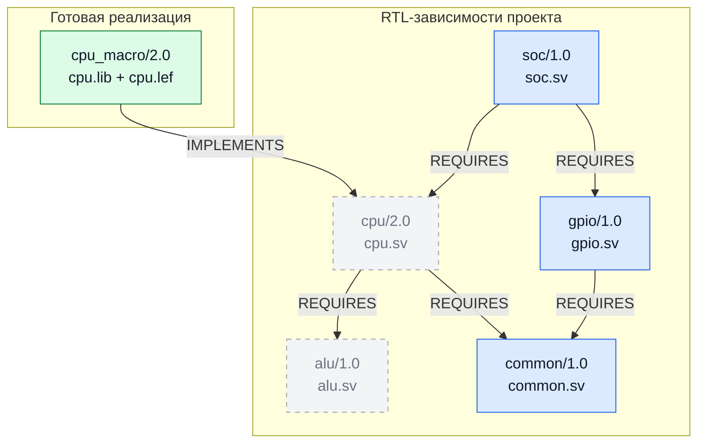

# Варианты использования

Каталог хранит сведения о версионированных объектах и их связях. Он может служить
общим источником данных для нескольких проектов, инструментов и процессов.

## Основные подходы

| Подход | Назначение |
|---|---|
| Реестр версий | Публиковать неизменяемые записи проектов, компонентов, наборов данных и результатов; искать их по общим координатам |
| Учёт зависимостей | Связывать объекты через REQUIRES и получать полный состав зависимостей выбранной версии |
| Разрешение совместимости | Объявлять допустимые замены версий и получать стабильный разрешённый граф для фиксированного корня |
| Альтернативные представления | Через IMPLEMENTS связывать разные реализации одного объекта и находить доступные варианты |
| Подготовка входных ресурсов | Хранить описания точных Git-коммитов и абсолютные пути к файлам; материализовать необходимые ресурсы перед работой |
| Учёт запусков | Сохранять параметры, версии инструментов и отчёты; связывать входы и новые результаты через USED и PRODUCED |
| Обмен промежуточными результатами | Публиковать самостоятельные артефакты, на точные версии которых могут ссылаться следующие этапы обработки |
| Повторное использование общих данных | Разделять библиотеки, конфигурации, модели и другие входные пакеты между независимыми проектами |
| Происхождение и влияние изменений | Через lineage прослеживать использование объектов, а через consumers находить непосредственных потребителей зависимости |
| Анализ и визуализация | Экспортировать граф в NetworkX для собственного анализа или просматривать сохранённые связи в Memgraph Lab |

## Пример: подготовка Genus с заменой RTL-блоков на LIB/LEF

Для синтеза верхнего уровня часть блоков можно представить готовыми макроблоками.
Каталог помогает получить точные зависимости и найти их реализации; подготовку
Tcl и вызов установленного Genus выполняет прикладной код.

1. Получить граф проекта через `catalog.graph.dependency_closure(top_ref)`.
   Для собственного обхода использовать `GraphResult.to_networkx()`.
2. Для каждого выбранного RTL-блока найти реализации через
   `catalog.graph.implementations(block_ref)`. Приложение выбирает нужный вариант
   и декодирует его payload с описаниями ресурсов LIB/LEF.
3. Исключить заменённый блок из списка читаемых RTL и продолжать обход только
   по оставшимся веткам. Зависимости, доступные также через другие RTL-блоки,
   сохранить. Изменяется состав входов запуска; опубликованные связи остаются прежними.
4. Получить локальные пути через `resource.materialize(cache_dir).path`, собрать
   оставшиеся RTL-файлы в порядке зависимостей и пути к LIB/LEF выбранных макроблоков.
   Передать эти входы в скрипт Genus. Технологические библиотеки, ограничения
   и остальные параметры синтеза добавляет прикладной скрипт.

### Граф каталога

В проекте SoC блок CPU заменяется готовым `cpu_macro`. GPIO продолжает обрабатываться
как RTL. Общий пакет common нужен GPIO, поэтому остаётся во входах; ALU требуется
только заменённому CPU и отдельно как RTL больше не читается.
Подписи вершин сокращены: каждая запись имеет полный Ref с namespace и kind.

Синие вершины дают RTL для этого запуска, зелёная — библиотечные представления.
Серые вершины остаются в каталоге, но не добавляют свои RTL-файлы во входы Genus.

| Вход Genus | Файлы примера |
|---|---|
| RTL | common.sv, gpio.sv, soc.sv |
| LIB | cpu.lib |
| LEF | cpu.lef |

Если макроблок реализует промежуточное представление, например результат DFT,
приложение проходит цепочку IMPLEMENTS несколькими запросами: implementations
возвращает только непосредственные реализации. Выбор представления и проверка
соответствия его интерфейса выбранному RTL-блоку остаются у приложения.

При необходимости запуск и результат можно опубликовать отдельными Record:
связать запуск с использованными входами через USED, а с новым результатом — через PRODUCED.

## Варианты расширения

Поверх API можно строить подготовку рабочих каталогов, интеграции с CI,
планировщики пересборок, сервисы поиска артефактов и панели отчётности.
Каталог предоставляет записи и связи; правила выбора, сравнения содержимого
и запуска задач реализует приложение.

Схемы payload и значения kind задаёт пользователь. Обход составных связей также
остаётся у приложения: implementations и consumers возвращают непосредственных соседей,
а lineage обходит связи происхождения USED/PRODUCED.

Подробнее: [структуры данных](data-model.md) и [интерфейсы](interfaces.md).
